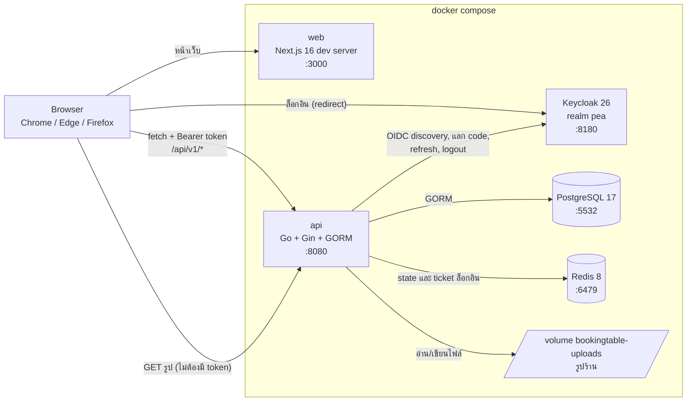
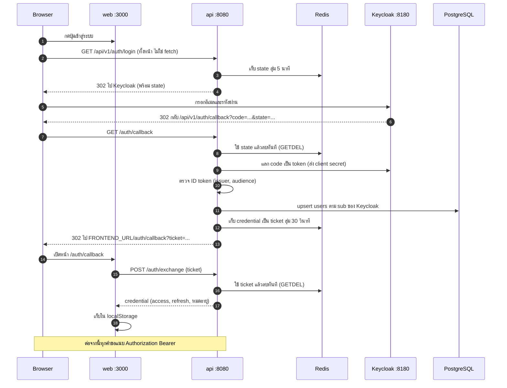
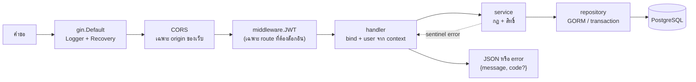
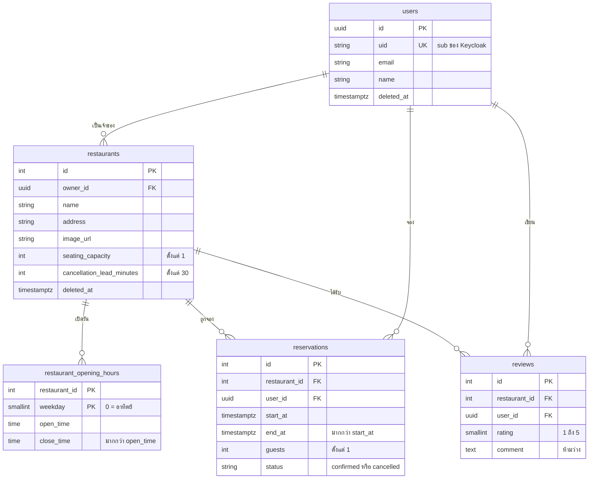
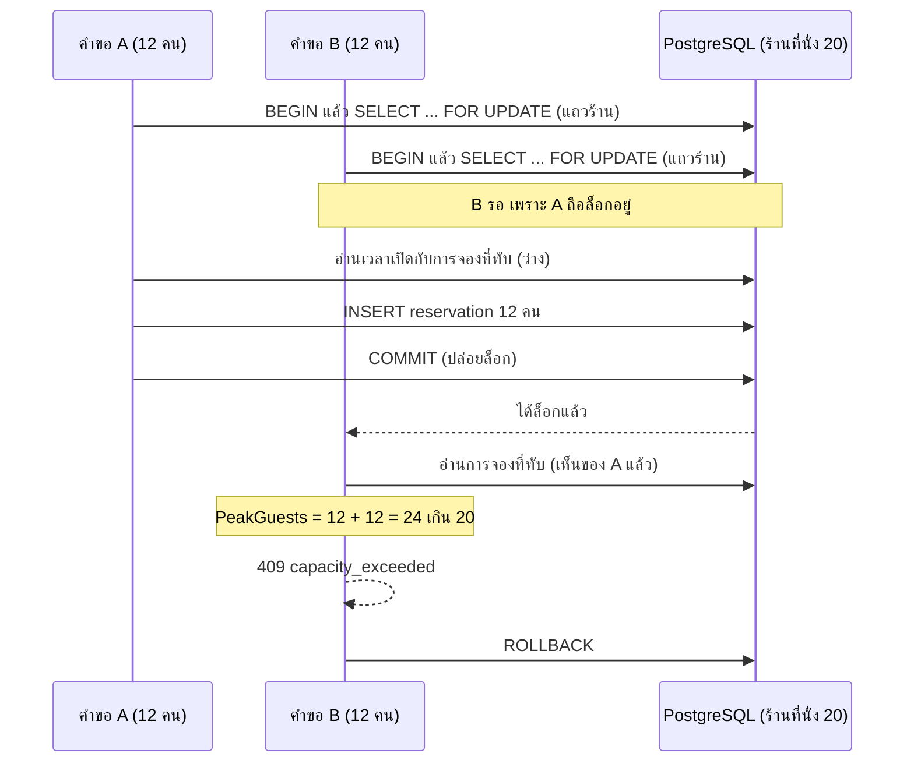
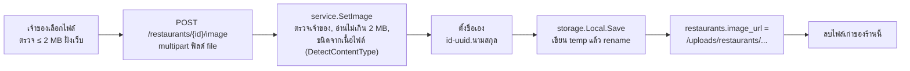
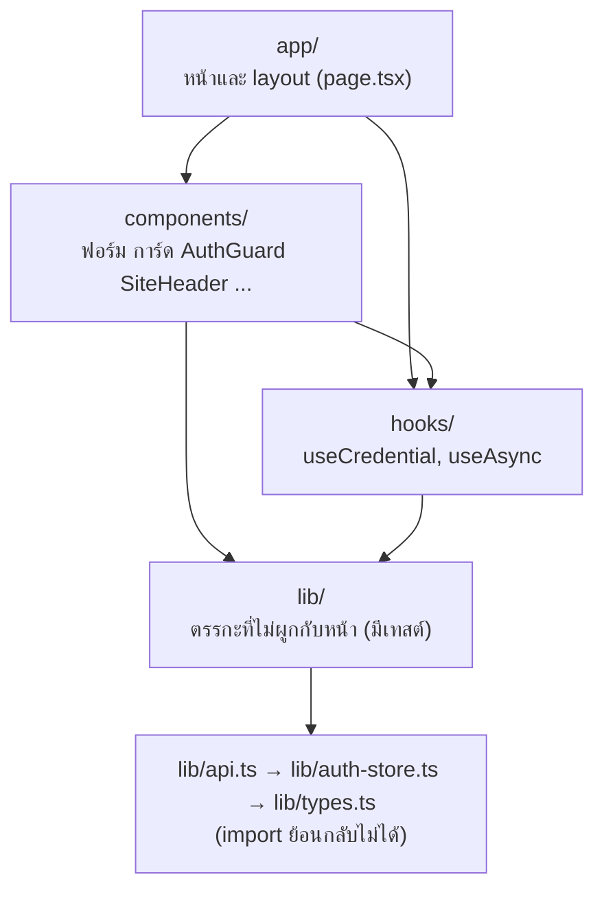

# Architecture

เอกสารนี้อธิบายว่า Booking Table ประกอบกันอย่างไรทั้งระบบ: มี service อะไร คุยกันอย่างไร ล็อกอินทำงานอย่างไร
กฎการจองกันจองเกินอย่างไร หน้าเว็บเรียก API อย่างไร และเลือกอะไรไว้เพราะอะไร
เขียนจากโค้ดที่ใช้งานจริง ทุกหัวข้อบอกไฟล์ต้นทางไว้ให้ไปตรวจต่อได้

วิธีรัน/ทดสอบอยู่ใน [README.md](README.md) สัญญาของ API ทีละ endpoint อยู่ใน [api/docs/API.md](api/docs/API.md)
ตารางข้อมูลและกฎการจองแบบละเอียดอยู่ใน [api/docs/ARCHITECTURE.md](api/docs/ARCHITECTURE.md) (ไฟล์นี้ลิงก์ไปแทนการคัดลอกซ้ำ)
ที่มาและเหตุผลตอนวางแผนอยู่ใน [docs/initial/](docs/initial/README.md)

## สารบัญ

1. [ภาพรวมและหลักการ](#1-ภาพรวมและหลักการ)
2. [ภาพรวม service](#2-ภาพรวม-service)
3. [การยืนยันตัวตน](#3-การยืนยันตัวตน)
4. [Backend](#4-backend)
5. [ข้อมูล](#5-ข้อมูล)
6. [ความถูกต้องของการจอง](#6-ความถูกต้องของการจอง)
7. [รูปร้าน](#7-รูปร้าน)
8. [Frontend](#8-frontend)
9. [คอนฟิกและการ deploy](#9-คอนฟิกและการ-deploy)
10. [ความปลอดภัย](#10-ความปลอดภัย)
11. [สถาปัตยกรรมการทดสอบ](#11-สถาปัตยกรรมการทดสอบ)
12. [การตัดสินใจและข้อจำกัด](#12-การตัดสินใจและข้อจำกัด)
13. [แผนที่โค้ด](#13-แผนที่โค้ด)

---

## 1. ภาพรวมและหลักการ

Booking Table คือระบบจองโต๊ะและรีวิวร้านชาบู/ปิ้งย่าง **บัญชีเดียวเป็นได้ทั้งเจ้าของร้านและลูกค้า** (ไม่มี role)
เจ้าของจัดการร้านของตัวเองและดูการจองของร้านแบบอ่านอย่างเดียว ลูกค้าค้นหา จอง แก้ ยกเลิก และรีวิว

หลักที่ทุกส่วนยึด:

| หลัก | ความหมายในโค้ด |
| --- | --- |
| **กฎสำคัญตรวจใน Go ทั้งหมด** | หน้าเว็บตรวจเพื่อให้ผู้ใช้เห็นเร็ว แต่ไม่เชื่อถือ: ทุกกฎ (เวลาเปิด ที่นั่ง ย้อนหลัง lead time สิทธิ์) ตรวจที่ service ของ API |
| **ข้อจำกัดใน DB เป็นด่านสุดท้าย** | `CHECK`, `UNIQUE`, foreign key ใน migration ซ้ำกับกฎของ Go เพื่อให้ข้อมูลผิดเข้ามาไม่ได้แม้โค้ดมีบั๊ก |
| **ผู้ใช้มาจาก token เท่านั้น** | ไม่มี endpoint ไหนรับ `ownerId`/`userId` จาก body หรือ query; handler อ่านจาก `reqctx.UserID` ที่ middleware ใส่ให้ |
| **เวลาตัดสินที่ `Asia/Bangkok`** | "เปิดวันจันทร์" หมายถึงวันจันทร์ตามเวลาไทย ไม่ขึ้นกับเขตเวลาของเครื่องหรือ browser |
| **คำขอพร้อมกันต้องไม่ทำให้จองเกิน** | ล็อกแถวร้านทุกครั้งที่เปลี่ยนการจอง (หัวข้อ 6) |
| **เทสต์ยิงของจริง** | เทสต์ของการจอง/ร้าน/รีวิวยิง HTTP จริงกับ PostgreSQL จริง ไม่ mock ชั้นข้อมูล (หัวข้อ 11) |

## 2. ภาพรวม service



| container | image / build | พอร์ตบนเครื่อง | หน้าที่ | ข้อมูลที่เก็บ |
| --- | --- | --- | --- | --- |
| `web` | build จาก `web/` (`node:24-alpine`) รัน `npm run dev` | 3000 | หน้าเว็บ (client component ทั้งหมด) | ไม่มี (token อยู่ใน `localStorage` ของ browser) |
| `api` | build จาก `api/` (Go 1.26 → `distroless/static:nonroot`) | 8080 | REST API, OAuth client ของ Keycloak, เสิร์ฟรูป | ไม่มี state ในตัว |
| `postgres` | `postgres:17` | 5532 | ฐานข้อมูลหลัก (`bookingtable`) | volume `…-pgdata` |
| `redis` | `redis:8.10-alpine` | 6479 | `state` ของ OAuth (5 นาที) และ ticket ล็อกอิน (30 วินาที) | ไม่มี volume: สูญหายเมื่อสร้าง container ใหม่ ผลคือผู้ใช้ที่กำลังล็อกอินอยู่กดใหม่ |
| `keycloak` | `quay.io/keycloak/keycloak:26.7` โหมด `start-dev --import-realm` | 8180 | ผู้ให้บริการยืนยันตัวตน (OIDC) realm `pea`, client `bookingtable` | volume `…-keycloak-data`; import realm จาก `keycloak/import/` ตอน volume ว่าง |

ที่มา: `compose.yml`, `api/Dockerfile`, `web/Dockerfile`

## 3. การยืนยันตัวตน

API เป็น OAuth client ของ Keycloak ส่วน browser ไม่เคยถือ client secret และ token ไม่เคยขึ้นใน URL: Keycloak ส่งผู้ใช้กลับมาที่ API
API แลก code เอง แล้วให้ browser ถือแค่ **ticket ใช้ครั้งเดียว อายุ 30 วินาที** ไปแลกเป็น token อีกที



หลังล็อกอิน แต่ละคำขอผ่าน `middleware.JWT`:

1. ต้องมี `Authorization: Bearer …` ไม่งั้น 401 `missing token`
2. `oidc.IDTokenVerifier` ตรวจลายเซ็น, issuer (จาก discovery ของ `KEYCLOAK_BASE_URL/realms/pea`) และ audience (ต้องมี `KEYCLOAK_CLIENT_ID`) ไม่ผ่าน 401 `invalid token`
3. แปลง `sub` ของ token เป็น `users.id` (UUID) ด้วย `ResolveID` ถ้าไม่พบ 401 `user not found` (ผู้ใช้ถูกสร้างตอนล็อกอินครั้งแรกใน `UpsertFromKeycloak`)
4. ใส่ `sub` และ `users.id` ลง `context` (`reqctx`) ให้ handler ใช้

อื่น ๆ:

- **refresh:** `POST /auth/refresh-token` เป็นตัวกลางไปที่ token endpoint ของ Keycloak (ส่ง client secret แทน browser) ฝั่งเว็บเรียกอัตโนมัติเมื่อได้ 401 (หัวข้อ 8)
- **logout:** `POST /auth/logout` บอก Keycloak ให้ยกเลิก refresh token (ต้องได้ 204)
- **ทำไมต้อง `keycloak.localhost:8180` ทั้งสองฝั่ง:** URL ที่ browser เปิดกับ `iss` ใน token ต้องตรงกับที่ API ใช้ทำ discovery
  `compose.yml` จึงตั้ง `KEYCLOAK_BASE_URL=http://keycloak.localhost:8180` และให้ container `api` ชี้ `keycloak.localhost` ไปที่ host ด้วย `extra_hosts: host-gateway`
  (browser รุ่นใหม่ resolve `*.localhost` เป็น loopback เอง)
- **Safari ล็อกอินไม่ได้:** Keycloak ตั้ง cookie แบบ `Secure` ผ่าน HTTP ซึ่ง Chrome/Edge/Firefox ยอมรับจาก `*.localhost` แต่ Safari ไม่ยอม

ที่มา: `api/internal/auth/{service,repository,handler}.go`, `api/internal/middleware/jwt.go`, `api/internal/user/service.go`, `api/internal/reqctx`

## 4. Backend

### ชั้นของโค้ด

แต่ละ feature (`restaurant`, `reservation`, `review`, `auth`, `user`) แบ่งเป็นชั้นเดียวกัน:

```text
handler     รับ/ตอบ HTTP เท่านั้น: bind JSON, อ่าน user จาก context, แปลง error เป็น status + code
   ↓
service     กฎธุรกิจและสิทธิ์ (ใครแก้ได้ เวลาไหน) ไม่รู้จัก HTTP หรือ GORM
   ↓
repository  GORM/SQL: query, transaction, ล็อกแถว
```

- **interface ประกาศฝั่งผู้ใช้ (consumer-side):** `service` ประกาศ `Repository` ที่ตัวเองต้องการ (เช่น `reservation.Repository`, `reservation.TxRepo`) ไม่ใช่ repository ประกาศให้ ทำให้สลับ/ทดสอบได้ง่าย
- **sentinel error + `errors.Is`:** แต่ละ feature มี `error.go` (`ErrCapacityExceeded`, `ErrForbidden` …) service ห่อด้วย `fmt.Errorf("…: %w", err)` แล้ว handler แปลงเป็น status ตรงจุดเดียว
- **DTO แยกจาก model:** `dto.go` กำหนดรูป JSON ของคำขอ/คำตอบ ไม่ปล่อย model ของ GORM ออก client

### แพ็กเกจ (`api/internal/`)

| แพ็กเกจ | หน้าที่ |
| --- | --- |
| `restaurant` | ร้าน, เวลาเปิดรายวัน, ค้นหา/เรียง/แบ่งหน้า, ลบแบบ soft delete พร้อมกันลบร้านที่มีการจองค้าง, รูปร้าน |
| `reservation` | จอง/แก้/ยกเลิก, มุมมองของฉัน และมุมมองเจ้าของ; `peak.go` (นับคนพร้อมกัน), `leadtime.go` (กฎเวลายกเลิก) |
| `review` | รีวิว 1 คนต่อ 1 ร้าน (ซ้ำกันด้วย unique key), แก้รีวิวของตัวเอง |
| `auth` | flow ล็อกอิน (state/ticket ใน Redis), refresh, logout |
| `user` | ผู้ใช้ (สร้างตอนล็อกอินครั้งแรก), `GET/PUT /users/me` |
| `middleware` | `JWT` (หัวข้อ 3) |
| `reqctx` | ใส่/อ่าน `sub` และ `users.id` ใน `context` |
| `httpapi` | `RegisterAPI` ต่อ route ของร้าน/การจอง/รีวิว, `CORSConfig` |
| `httputil` | `ErrorResponse{message, code?}` และ `ListResponse[T]{total, results}` |
| `storage` | เขียน/ลบไฟล์รูปบนดิสก์แบบอะตอมมิก (`Local`) |
| `config` | อ่านและตรวจ environment variable (หัวข้อ 9) |
| `platform/{database,cache}` | เปิดการเชื่อมต่อ PostgreSQL และ Redis |
| `apitest` | เทสต์ที่ยิง HTTP จริง (หัวข้อ 11) |

### จุดต่อสาย (wiring)

`cmd/api/main.go` ต่อ `auth` และ `user` เอง ส่วน **ร้าน/การจอง/รีวิวต่อใน `httpapi.RegisterAPI(v1, Deps{DB, Auth, Now, UploadDir})`**
เพื่อให้ production กับเทสต์ใช้ handler/service/repository ชุดเดียวกัน ต่างกันแค่ `Deps`: production ส่ง `middleware.JWT` และ `time.Now`
เทสต์ส่งตัวอ่าน header `X-Test-User` และนาฬิกาที่ตรึงไว้

### วงจรคำขอ



### สัญญา error

ทุก error เป็น `{"message": "...", "code": "..."}` (`code` มีเฉพาะกฎธุรกิจที่ frontend ต้องแยกแยะ) ข้อความภายในของ server ไม่หลุดออกไป:
error ที่ไม่รู้จักตอบ `500 internal server error` เฉย ๆ

| error ในโค้ด | status | `code` |
| --- | --- | --- |
| `ErrRestaurantNotFound` / `ErrReservationNotFound` / `ErrReviewNotFound` | 404 | — |
| `ErrForbidden` (ไม่ใช่เจ้าของ/ผู้จอง) | 403 | — |
| `ErrInvalidInput` | 400 | — |
| `ErrStartInPast` | 400 | `start_in_past` |
| `ErrOutsideOpeningHours` | 400 | `outside_opening_hours` |
| `ErrInvalidImage` | 400 | `invalid_image` |
| `ErrCapacityExceeded` | 409 | `capacity_exceeded` |
| `ErrNotActive` (ยกเลิกแล้วหรือเริ่มไปแล้ว) | 409 | `reservation_not_active` |
| `ErrTooLateToCancel` / `ErrTooLateToModify` | 409 | `too_late_to_cancel` / `too_late_to_modify` |
| `ErrHasActiveReservations` (ลบร้านไม่ได้) | 409 | `restaurant_has_active_reservations` |
| `ErrAlreadyReviewed` | 409 | `already_reviewed` |
| `ErrOwnRestaurant` (รีวิวร้านตัวเอง) | 403 | `cannot_review_own_restaurant` |
| token ขาด/ไม่ถูกต้อง | 401 | — |

ที่มา: `handler.go` ของ `restaurant`, `reservation`, `review` และ `middleware/jwt.go`

### แผนที่ route (ย่อ)

| กลุ่ม | route | ต้องล็อกอิน |
| --- | --- | --- |
| auth | `GET /auth/login`, `GET /auth/callback`, `POST /auth/exchange`, `POST /auth/refresh-token`, `POST /auth/logout` | ไม่ |
| users | `GET/PUT /users/me` (id อื่นตอบ 404) | ใช่ |
| ร้าน | `POST/GET /restaurants`, `GET/PUT/DELETE /restaurants/{id}`, `POST/DELETE /restaurants/{id}/image` | ใช่ (เจ้าของเท่านั้นสำหรับ PUT/DELETE/image) |
| การจอง | `POST/GET /restaurants/{id}/reservations` (GET = มุมมองเจ้าของ), `GET /restaurants/{id}/availability?date=` (ช่วงว่างรายชั่วโมง), `GET /reservations`, `PUT /reservations/{id}`, `POST /reservations/{id}/cancel` | ใช่ |
| รีวิว | `POST/GET /restaurants/{id}/reviews`, `PUT /restaurants/{id}/reviews/me`, `GET /reviews` (รีวิวของฉันทุกร้าน) | ใช่ |
| รูป | `GET /uploads/restaurants/{file}` | **ไม่** (หัวข้อ 7) |
| เอกสาร | `GET /swagger/*` (อยู่นอก `/api/v1`) | ไม่ |

รายละเอียดของแต่ละ route (body, query, สิทธิ์, ผลลัพธ์) อยู่ใน [api/docs/API.md](api/docs/API.md)

## 5. ข้อมูล



- **soft delete** (`deleted_at`) เฉพาะ `users` และ `restaurants` ร้านที่ลบแล้วหายจากรายการและตอบ 404 แต่การจองเก่ายังแสดงชื่อร้านได้
- **การจองไม่ถูกลบ** ยกเลิกคือเปลี่ยน `status` เป็น `cancelled` (การจองที่ยกเลิกไม่นับที่นั่ง)
- **เวลาเปิดถูกแทนทั้งชุด** เมื่อแก้ร้าน: วันไหนไม่มีแถว = ปิด จึงไม่มี `deleted_at`
- **คะแนนเฉลี่ยและจำนวนรีวิวไม่ถูกเก็บ** คำนวณสดจากตาราง `reviews` ทุกครั้ง (ทั้งตอนแสดงและตอนเรียงลำดับ)
- เวลาเก็บเป็น `timestamptz` ทั้งหมด; เวลาเปิด/ปิดเป็น `time` ที่ตีความตามเวลาไทย
- schema เปลี่ยนได้ทางเดียวคือ migration ของ goose ใน `api/migrations/` และ `CHECK` ใน migration คือกฎเดียวกับที่โค้ด Go ตรวจ (ด่านสุดท้าย)

ที่มา: `api/migrations/*.sql` รายละเอียดเพิ่มที่ [api/docs/ARCHITECTURE.md](api/docs/ARCHITECTURE.md)

## 6. ความถูกต้องของการจอง

นี่คือส่วนที่ซับซ้อนที่สุดของระบบ ที่มา: `api/internal/reservation/{service,peak,leadtime,repository}.go`

### การจองคือช่วงเวลาแบบ `[start, end)`

การจองที่จบ 12:00 กับที่เริ่ม 12:00 **ไม่ทับกัน** (ปลายเปิด) การจองต้องอยู่ในวันเดียวกัน (ตามเวลาไทย) และอยู่ในเวลาเปิดของวันนั้นทั้งช่วง
(เวลาจบเท่ากับเวลาปิดพอดีได้) client ส่งเวลาเป็น offset ใดก็ได้ API แปลงเป็น `Asia/Bangkok` ก่อนเทียบ
(โหลด zone ผ่าน `time/tzdata` เพราะ image `distroless` ไม่มี zoneinfo ของระบบ)

### ลำดับการตรวจ (`service.check`)

ตรวจจากถูกไปแพง และตอบด้วยข้อแรกที่ไม่ผ่าน:

1. `end` ต้องหลัง `start` และ `guests ≥ 1` ไม่งั้น `400`
2. `start` ต้องไม่ก่อนตอนนี้ ไม่งั้น `400 start_in_past`
3. อยู่ในเวลาเปิดของวันเดียว ไม่งั้น `400 outside_opening_hours`
4. คนที่อยู่พร้อมกันสูงสุดต้องไม่เกินที่นั่ง ไม่งั้น `409 capacity_exceeded`

### นับ "คนที่อยู่พร้อมกันสูงสุด" ไม่ใช่ผลรวม

`PeakGuests(existing, candidate)` ดูทุกจุดที่จำนวนคนเปลี่ยนภายในช่วงของผู้จองใหม่ (เวลาเริ่มของผู้จองใหม่ และเวลาเริ่มของการจองเดิมที่ตกในช่วง)
แล้วหาค่าสูงสุดของคนที่อยู่ ณ จุดนั้น + คนของผู้จองใหม่ ถ้ารวมทุกการจองที่ทับกันจะปฏิเสธการจองที่ใส่ได้จริง
เช่น 10:00–12:00 กับ 12:00–14:00 ต่อให้ผู้จองใหม่ 11:00–13:00 ไม่เคยมีสองกลุ่มนั้นอยู่พร้อมกัน
ตอนแก้การจอง `check` รับ `excludeID` เพื่อไม่นับที่นั่งเดิมของการจองที่กำลังแก้

### ช่วงว่างรายชั่วโมงเป็นข้อมูลประกอบ ไม่ใช่ตัวตัดสิน

`GET /restaurants/{id}/availability?date=YYYY-MM-DD` ตัดเวลาเปิดของวันนั้น (เวลาไทย) เป็นช่องละหนึ่งชั่วโมงแล้วหา "คนที่อยู่พร้อมกันสูงสุด" ของแต่ละช่องด้วย `PeakGuests` ตัวเดียวกับตอนจอง
(`reservation/service.go` `Availability`, `hourlySlots`) และใช้ query "จองไหนนับ" ตัวเดียวกัน (`confirmedOverlapping`) แต่ **อ่านโดยไม่ล็อกแถวร้าน** จึงอาจล้าหลังไปชั่วขณะ
ช่องที่ยังมีที่นั่งอาจตอบ `409 capacity_exceeded` ตอนกดจองได้ถ้ามีคนจองตัดหน้า เพราะการจองจริงตรวจซ้ำใต้ล็อกเสมอ หน้าเว็บบอกผู้ใช้เรื่องนี้ใต้ตารางช่วงว่าง

### ล็อกแถวร้านทุกครั้งที่เปลี่ยนการจอง

`reservation.repository.InTx` เปิด transaction แล้ว `SELECT … FOR UPDATE` แถวของร้านก่อนอ่านอะไรอื่น
**เวลาเปิดและที่นั่งอ่านหลังได้ล็อก** คำขอของร้านเดียวกันจึงเรียงกันทีละคำขอและเห็นผลที่ commit ของคำขอก่อนหน้าเสมอ ส่วนร้านอื่นไม่ต้องรอ



### กฎอื่นที่ต้องไม่หลุด

- **แก้และยกเลิกใช้กฎเดียว** (`ensureChangeable`): ต้อง `confirmed`, ยังไม่เริ่ม (`409 reservation_not_active`) และเวลาเริ่ม**เดิม**ต้องห่างจากตอนนี้อย่างน้อย `cancellation_lead_minutes`
  (ห่างพอดีเท่ากับ lead time ยังทำได้) ไม่งั้น `too_late_to_modify` / `too_late_to_cancel` การแก้ต้องผ่านข้อ 1–4 ใหม่ด้วย
- **ลบร้านใช้ล็อกเดียวกัน:** `restaurant.repository.DeleteIfNoActiveReservations` ล็อกแถวร้านแล้วนับการจอง `confirmed` ที่ยังไม่จบ จึงไม่มีการจองแทรกระหว่างตรวจกับลบ
  อย่างใดอย่างหนึ่งเกิดก่อน: จองสำเร็จแล้วลบถูกปฏิเสธ หรือลบสำเร็จแล้วการจองไม่พบร้าน
- **รีวิวซ้ำกันด้วย unique key ไม่ใช่ check-then-insert:** `reviews` มี `UNIQUE (user_id, restaurant_id)` และ repository แปลง error รหัส `23505` ของ PostgreSQL เป็น `ErrAlreadyReviewed`
  ถ้าสองคำขอมาพร้อมกันสำเร็จหนึ่ง ซ้ำหนึ่ง
- **เจ้าของรีวิวร้านตัวเองไม่ได้** ตรวจที่ service (`ErrOwnRestaurant`) ส่วนเจ้าของ**จองร้านตัวเองได้** (ไม่มีกฎห้าม)

### อะไรพิสูจน์ว่าถูก

| กฎ | เทสต์ (ใน `api/internal/…`) |
| --- | --- |
| นับคนพร้อมกัน (รวมเคสต่อกันพอดีและเคสที่การจองเดิมซ้อนกันเอง) | `reservation/peak_test.go` (ตารางเคส 10 เคส) |
| lead time (ห่างพอดีเท่ากับ lead time ยังทำได้) | `reservation/leadtime_test.go`, `TestReservationCancel_LeadTimeBoundary`, `TestReservationUpdate_LeadTimeBoundary` |
| เวลาจาก client แปลงเป็นเวลาไทยก่อนเทียบเวลาเปิด, ที่นั่ง | `TestReservationCreate_UTCInputConvertedToBangkok`, `TestReservationCreate_Capacity` (`apitest/reservation_create_test.go`) |
| แก้การจองไม่นับที่นั่งเดิม และใช้กฎเดียวกับตอนจอง | `TestReservationUpdate_ExcludesOwnAllocation`, `TestReservationUpdate_AppliesTheSameRulesAsBooking` |
| จองพร้อมกันไม่เกินที่นั่ง | `TestReservationCreate_ConcurrentRequestsNeverOverbook` |
| ย้ายการจองพร้อมกันไม่เกินที่นั่ง | `TestReservationUpdate_ConcurrentMovesNeverOverbook` |
| ยกเลิกซ้ำพร้อมกันสำเร็จครั้งเดียว | `TestReservationCancel_ConcurrentCancelsSucceedOnce` |
| ลบร้านแข่งกับการจองแล้วข้อมูลยังสอดคล้อง | `TestRestaurantDelete_RacingWithBookingsStaysConsistent` (`apitest/owner_view_test.go`) |
| รีวิวซ้ำพร้อมกันได้รีวิวเดียว | `TestReviewCreate_ConcurrentDuplicatesYieldOneReview` |

เทสต์ concurrency ผ่านการทดลองถอดล็อกออกแล้วล้มจริง (ไม่ใช่ผ่านเพราะบังเอิญ)

## 7. รูปร้าน



- **ชนิดจากเนื้อไฟล์เท่านั้น:** ยอมรับ JPEG/PNG/WebP ตาม `http.DetectContentType` ไม่ดูนามสกุลหรือ `Content-Type` ที่ client ส่ง ไฟล์ว่าง/เกิน 2 MB/GIF/SVG/ไฟล์ข้อความชื่อ `.png` ได้ `400 invalid_image`
- **ชื่อไฟล์ server ตั้งเอง** (`<id>-<uuid>.<ext>`) ไม่เอาชื่อจาก client และ `storage.Local` ปฏิเสธชื่อที่เป็น path จึงออกนอกโฟลเดอร์ไม่ได้
- **เขียนแบบอะตอมมิก:** เขียนลงไฟล์ชั่วคราว (`.upload-*`) แล้ว `rename` อัปโหลดล้มเหลวจึงไม่ทิ้งรูปครึ่งเดียว
- **เสิร์ฟสาธารณะ** ที่ `/api/v1/uploads/restaurants/<ชื่อ>` โดยไม่ต้องมี token เพราะ `` แนบ `Authorization` ไม่ได้ ชื่อไฟล์เป็น UUID สุ่ม เก็บเฉพาะสามชนิดที่อนุญาต
  และตอบ `X-Content-Type-Options: nosniff` เพื่อกัน browser เดาชนิดเอง
- **ที่เก็บ:** `UPLOAD_DIR` (ใน compose คือ `/app/uploads` บน volume `bookingtable-uploads`) API รันเป็นผู้ใช้ nonroot `65532` และ Dockerfile สร้าง `uploads/restaurants` ให้เป็นของผู้ใช้นั้น
- **รูปตัวอย่าง** เป็นไฟล์ ไม่ใช่แถวใน DB: `seed.sql` ใส่ `image_url` แล้ว `scripts/seed_images.sh` คัดลอกไฟล์ลง volume (เครดิตใน `api/seed/images/CREDITS.md`)
- ฝั่งเว็บต่อ URL รูปด้วย `API_BASE + imageUrl` (`assetUrl` ใน `web/lib/api.ts`) และแสดงกล่อง "ไม่มีรูป" เมื่อ `imageUrl` เป็น `null`

ที่มา: `api/internal/restaurant/service.go`, `api/internal/storage/local.go`, `api/internal/httpapi/api.go`

## 8. Frontend

Next.js 16 (App Router) + TypeScript + Tailwind v4 + shadcn/ui **ทุกหน้าเป็น client component** เพราะทุก endpoint ต้องใช้ Bearer token ซึ่งอยู่ใน browser จึงไม่มีข้อมูลสาธารณะให้ render บน server
(ข้อสังเกตเฉพาะ Next 16 อยู่ที่ [web/NOTES.md](web/NOTES.md))

### หน้าและ API ที่เรียก

| route | หน้า | API ที่เรียก |
| --- | --- | --- |
| `/` | ยังไม่ล็อกอิน: หน้าแนะนำระบบ (ไม่เรียก API) ล็อกอินแล้ว: ทักทาย ค้นหา การจองถัดไป ร้านคะแนนสูงสุด และรายการร้านเรียง/แบ่งหน้า (12 ต่อหน้า) | `GET /restaurants?name&sort&page&limit`, `GET /restaurants?sort=rating&limit=3`, `GET /reservations`, `GET /users/me` |
| `/restaurants/[id]` | รายละเอียดร้าน ช่วงว่างรายชั่วโมง จอง รีวิว | `GET /restaurants/{id}`, `GET …/availability?date`, `GET …/reviews`, `POST …/reservations`, `POST …/reviews`, `PUT …/reviews/me` |
| `/my/profile` | ข้อมูลส่วนตัว (แก้คำแนะนำตัว) สถิติการใช้งาน การจองถัดไป รีวิวของฉัน | `GET /users/me`, `PUT /users/me`, `GET /reservations`, `GET /restaurants?mine=true&limit=1`, `GET /reviews` |
| `/my/reservations` | การจองของฉัน แก้/ยกเลิก | `GET /reservations`, `PUT /reservations/{id}`, `POST /reservations/{id}/cancel` |
| `/my/restaurants` | ร้านของฉัน สรุปจำนวนร้าน/รีวิว/คะแนน ลบร้าน | `GET /restaurants?mine=true`, `DELETE /restaurants/{id}` |
| `/my/restaurants/new` | สร้างร้าน | `POST /restaurants` |
| `/my/restaurants/[id]/edit` | แก้ร้านและรูป | `GET/PUT /restaurants/{id}`, `POST/DELETE …/image` |
| `/my/restaurants/[id]/reservations` | การจองของร้าน (อ่านอย่างเดียว) พร้อมสถิติ กรองสถานะฝั่งเว็บเพื่อให้ตัวเลขไม่เปลี่ยนตามตัวกรอง | `GET /restaurants/{id}`, `GET /restaurants/{id}/reservations` |
| `/auth/callback` | รับ ticket หลังล็อกอิน | `POST /auth/exchange` |

### ชั้นของโค้ด (`web/`)



โค้ดที่เสี่ยงและทดสอบได้อยู่ใน `web/lib` (ไม่พึ่ง React/DOM) ส่วนหน้าและคอมโพเนนต์บางที่สุด

### API client (`web/lib/api.ts`)

`apiFetch(path, { method, body, auth })` คือทางเดียวที่หน้าเว็บคุยกับ API สร้างจาก `createApiFetch({ fetchFn, store, baseUrl, onAuthLost })` (รับ dependency เข้ามาเพื่อทดสอบได้):

- แนบ `Authorization: Bearer` ถ้ามี token (ยกเว้นเรียกด้วย `auth: false` สำหรับ `/auth/*`)
- `body` เป็น `FormData` → ส่งตรงโดย**ไม่ตั้ง `Content-Type`** (ให้ browser ใส่ boundary เอง) อย่างอื่น → `JSON.stringify` + `application/json`
- ตอบ `204` → คืน `undefined` ไม่เรียก `json()`; ตอบ error → โยน `ApiError{status, code?}` จาก `{message, code}`
- **ได้ 401 ขณะส่ง token:** refresh แบบ **single-flight** (promise เดียวที่ทุกคำขอที่ 401 พร้อมกันรอร่วมกัน เพราะ refresh token หมุนทุกครั้ง ครั้งที่สองจะล้ม)
  แล้วส่งคำขอเดิมซ้ำ**ครั้งเดียว** ถ้ามีคำขออื่น refresh ไปแล้ว (token ใน store ไม่ใช่ตัวเดิม) ก็ใช้ตัวใหม่ ไม่ refresh ซ้ำ
- refresh ถูกปฏิเสธหรือไม่มี refresh token → ล้าง credential และ `onAuthLost` (พาไป `/auth/login` ทั้งหน้า; ถ้า Keycloak ยังมี session อยู่ จะกลับมาล็อกอินให้เองโดยไม่ต้องกรอกใหม่)
  แต่ถ้าเครือข่ายล้มระหว่าง refresh จะ**ไม่**ล็อกเอาต์ผู้ใช้ (error ผ่านขึ้นไปตรง ๆ)

### สถานะล็อกอิน

- `lib/auth-store.ts`: เก็บ credential ทั้งก้อนเป็น JSON ใต้คีย์เดียว `bookingtable.credential` ใน `localStorage` ทุกการเข้าถึงครอบ try/catch และ SSR-safe;
  `set/clear` ส่ง event `bookingtable:auth` ให้แท็บเดียวกันรู้ (แท็บอื่นรู้จาก event `storage`)
- `hooks/use-credential.ts`: ใช้ `useSyncExternalStore` ฟังสอง event นั้น คืน `undefined` ก่อน mount, `null` เมื่อยังไม่ล็อกอิน (snapshot ถูก cache ไว้ ไม่งั้น parse JSON ใหม่ทุกครั้งแล้ววนไม่จบ)
- `components/auth-guard.tsx`: แสดงลูกเมื่อมี credential เท่านั้น คอมโพเนนต์ที่ดึงข้อมูลจึงถูก mount เฉพาะตอนล็อกอินแล้ว (ไม่ยิง API ตอนยังไม่ล็อกอิน)
- `app/auth/callback/page.tsx`: ใช้ `useRef` กันการแลก ticket ซ้ำ เพราะ React Strict Mode รัน effect สองรอบใน dev และ ticket ใช้ได้ครั้งเดียว

### การโหลดข้อมูลและสถานะของหน้า

- `hooks/use-async.ts`: `useAsync(fn, deps)` รันใหม่เมื่อ `deps` เปลี่ยน (เทียบตามค่า) หรือเรียก `reload()`; คงข้อมูลล่าสุดไว้ระหว่างโหลดใหม่ (รายการไม่กะพริบ);
  คำตอบที่มาช้าหลัง input เปลี่ยนหรือหลัง unmount ถูกทิ้ง
- หน้ารายการ **เก็บสถานะ (`name`, `sort`, `page`) ไว้ใน URL** รีเฟรช ย้อนกลับ และแชร์ลิงก์จึงได้ผลค้นหาเดิม

### เวลา ข้อความ และธีม

- **เวลา** (`lib/datetime.ts`): ค่าจาก `<input type="datetime-local">` คือเวลาไทย `toApiDateTime` ต่อ `:00+07:00` ด้วยสตริง (ไม่ใช้ `Date` ท้องถิ่น) `fromApiDateTime` แปลงกลับเป็นเวลาไทยด้วยการบวก 7 ชั่วโมง
  `formatThaiDateTime` ใช้ `Intl` เขตเวลา `Asia/Bangkok` ทั้งหมดจึงไม่ขึ้นกับเขตเวลาของ browser (เทสต์รันด้วย `TZ=America/New_York` เพื่อจับโค้ดที่พึ่งเขตเวลาเครื่อง)
- **ข้อความผิดพลาด** (`lib/errors.ts`): `messageForError` แปลง `code` เป็นข้อความไทย ถ้าไม่มี `code` ใช้ตาม status และ `isNotFound` ใช้แยก 404
- **เวลาเปิดรายวัน** (`lib/opening-hours.ts`): แปลงระหว่างรายการจาก API กับแถว 7 วันของฟอร์ม ตรวจก่อนส่ง (ต้องเปิดอย่างน้อย 1 วัน, เวลาครบ, ปิดหลังเปิด); weekday 0 (อาทิตย์) ต้องไม่หายเพราะเป็นค่า falsy
- **ธีม:** token สี (โทนฟ้าแบบ Facebook) อยู่ใน `web/app/globals.css` (`--primary`, `--primary-strong` สำหรับตัวหนังสือสีฟ้า, `--primary-subtle`) และฟอนต์ Noto Sans Thai ใน `app/layout.tsx`;
  ปุ่มใช้ `components/bases/button.tsx` ส่วน primitive อื่นมาจาก shadcn ใน `components/ui/`

ที่มา: `web/lib/*`, `web/hooks/*`, `web/app/*`, `web/components/*`

## 9. คอนฟิกและการ deploy

### ตัวแปรสภาพแวดล้อม

**ราก (`.env`, คัดลอกจาก `.env.example`, ไม่ถูก commit)** ส่งเข้า compose: `POSTGRES_PASSWORD`, `KC_ADMIN_PASSWORD`, `KEYCLOAK_CLIENT_SECRET`
compose ปฏิเสธการสตาร์ทถ้าขาดตัวใดตัวหนึ่ง (`${VAR:?…}`) `api/.env` ใช้กับ goose เท่านั้น

**API (`internal/config`)** ค่าเริ่มต้นเมื่อไม่ตั้ง:

| ตัวแปร | ค่าเริ่มต้น | ใช้ทำอะไร |
| --- | --- | --- |
| `APP_NAME` / `APP_ENV` / `APP_SHUTDOWN` | `bookingtable` / `development` / `10s` | ชื่อใน log, โหมด, เวลารอปิดอย่างนุ่มนวล |
| `APP_PORT` | `8080` | ถูกตรวจแต่ **ยังไม่ถูกใช้**: `main.go` ฟังที่ `:8080` ตายตัว (ดูหัวข้อ 12) |
| `POSTGRES_DSN` | — (ต้องตั้ง) | การเชื่อมต่อฐานข้อมูล (compose ประกอบจาก `POSTGRES_PASSWORD`) |
| `REDIS_HOST` / `REDIS_PORT` / `REDIS_PASSWORD` / `REDIS_DB` | `localhost` / `6380` / — / `0` | Redis |
| `KEYCLOAK_BASE_URL` / `KEYCLOAK_REALM` | `http://localhost:8081` / `pea` | ที่อยู่ Keycloak และ realm (ใน compose: `http://keycloak.localhost:8180`) |
| `KEYCLOAK_CLIENT_ID` / `KEYCLOAK_CLIENT_SECRET` | — (ต้องตั้ง) | client `bookingtable` |
| `KEYCLOAK_REDIRECT_URL` | `http://localhost:8080/api/v1/auth/callback` | ที่ Keycloak ส่งผู้ใช้กลับมา |
| `FRONTEND_URL` | `http://localhost:3000` | ปลายทางหลังล็อกอินและ origin เดียวที่ CORS อนุญาต |
| `UPLOAD_DIR` | `./uploads` | โฟลเดอร์รูปร้าน |
| `LOG_LEVEL` / `LOG_FORMAT` | `DEBUG` / `json` | log (`slog`) |

**Web:** ตัวแปรเดียวที่ browser ต้องรู้คือ `NEXT_PUBLIC_API_BASE_URL` (ค่าเริ่มต้น `http://localhost:8080/api/v1`) ค่าถูกฝังลง bundle จึงต้องเป็น URL ที่ browser บนเครื่อง host เรียกถึงได้
(ไม่ใช่ `http://api:8080`) ห้ามใส่ความลับในตัวแปร `NEXT_PUBLIC_*`

### Docker

- **api:** multi-stage: build ด้วย `golang:1.26-alpine` เป็นไบนารี static แล้วรันบน `distroless/static:nonroot` (ผู้ใช้ `65532`, ไม่มี shell) พร้อม tzdata และโฟลเดอร์ uploads ที่เป็นของผู้ใช้นั้น
- **web:** image แบบ dev (`next dev`) ที่ bind mount `./web` เข้า `/app` ให้ hot reload (บน Colima การจับไฟล์ที่แก้อาจพลาด: `docker compose restart web`) ไม่ใช่ image สำหรับ production
- **migration ไม่รันตอนสตาร์ท:** รัน `goose up` เองหลังขึ้น stack ส่วน `seed.sql` และ `seed_images.sh` ไม่บังคับและรันซ้ำได้

## 10. ความปลอดภัย

| เรื่อง | วิธีที่ทำ |
| --- | --- |
| ตัวตน | ตรวจ JWT ทุกคำขอ (ลายเซ็น issuer audience) ด้วย `go-oidc`; client secret อยู่ที่ API เท่านั้น |
| สิทธิ์ | ตรวจที่ชั้น service จากข้อมูลจริงใน DB (เจ้าของร้าน/ผู้จอง) ไม่เชื่อ id จาก client; ฟิลด์ที่ไม่รู้จักใน body ถูกละเลย (ส่ง `ownerId` มาก็ไม่มีผล) |
| CORS | อนุญาตเฉพาะ origin `FRONTEND_URL`, เมธอด GET/POST/PUT/DELETE/OPTIONS, header `Authorization` และ `Content-Type` (`cors.Default()` ไม่อนุญาต `Authorization`) |
| SQL | ใช้พารามิเตอร์ของ GORM ทุกที่; การค้นหาชื่อ escape `%`, `_` และ `\` ก่อนใส่ `ILIKE … ESCAPE` ให้เป็นตัวอักษรธรรมดา |
| ข้อมูลเข้า | ตรวจความยาว ช่วงตัวเลข (32 บิต) และ NUL (PostgreSQL เก็บ NUL ไม่ได้ ไม่ตรวจจะกลายเป็น 500) |
| รูป | ชนิดจากเนื้อไฟล์, ชื่อสุ่ม, `nosniff`, ชื่อเป็น path ไม่ได้ (หัวข้อ 7) |
| ข้อความ error | ไม่เปิดเผยรายละเอียดภายใน error ที่ไม่รู้จักตอบ 500 กว้าง ๆ |
| ความลับ | `.env` ไม่ถูก commit, compose ปฏิเสธการสตาร์ทถ้าขาดความลับ, ประวัติ git ผ่านการล้างค่าลับเก่าแล้ว |
| ข้อแลกเปลี่ยน | เว็บเก็บ token ใน `localStorage` (ง่ายสุดสำหรับงานสอบ) เสี่ยงต่อ XSS ถ้าใช้จริงควรเปลี่ยนเป็น cookie แบบ HttpOnly |
| เฉพาะ dev | Keycloak `start-dev` ผ่าน HTTP, realm ที่ import ยังมีรหัสผ่านแบบ hash และ key ของโปรเจกต์ต้นแบบ ห้ามนำไปใช้จริง |

## 11. สถาปัตยกรรมการทดสอบ

| ชั้น | อยู่ที่ไหน | ทดสอบอะไร | ช้า/เร็ว |
| --- | --- | --- | --- |
| Go unit (ฟังก์ชันบริสุทธิ์) | `reservation/peak_test.go`, `leadtime_test.go`, `storage/local_test.go` | นับคนพร้อมกัน กฎ lead time การเขียนไฟล์ | เร็วมาก |
| Go HTTP-seam | `api/internal/apitest` | พฤติกรรมของ API ทั้งเส้น: router จริง + service + repository + PostgreSQL จริง | ปานกลาง (ใช้ Docker) |
| Go mock (เดิมจากต้นแบบ) | `auth`, `user`, `middleware` (`mocks_test.go` สร้างด้วย mockery), `httpapi/cors_test.go` | flow auth/user และ CORS | เร็ว |
| Vitest | `web/lib/*.test.ts` | API client + refresh, เวลา, error, เวลาเปิด, auth store | เร็วมาก |
| เบราว์เซอร์จริง | `scripts/browser_e2e` | UI ทั้งหมดผ่าน Chrome จริง ~100 ข้อ รวม Strict Mode และ token หมดอายุ | ช้า (ต้องมี stack) |
| Smoke ของ API | `scripts/smoke_api.py` | ล็อกอินจริงผ่าน Keycloak แล้วไล่ flow หลักด้วย HTTP | ช้า (ต้องมี stack) |

หลักการเขียนเทสต์ของการจอง/ร้าน/รีวิว:

- **ยิงที่ขอบ HTTP** (seam เดียว) แล้วดูผลที่ response ไม่ mock repository เพราะบั๊กที่น่ากลัวของระบบนี้คือการแข่งกันและ constraint ของ DB ซึ่ง mock มองไม่เห็น
- **schema ของเทสต์คือ migration จริง:** harness ดึงส่วน `Up` ของทุกไฟล์ใน `api/migrations` ไปรันใน container `postgres:17` ตัวเดียวที่ใช้ร่วมกัน แล้ว `TRUNCATE … RESTART IDENTITY` ก่อนแต่ละเทสต์
- **นาฬิกาตรึง** ที่วันจันทร์ 2026-10-12 09:00 (+07:00) และ **ผู้ใช้จำลอง** ผ่าน header `X-Test-User` (ไม่มี = 401) จึงทดสอบเวลาและสิทธิ์ได้แน่นอน
- **เทสต์การแข่งกันต้องทับกันจริง:** `warmPool` อุ่น connection ไว้ก่อน (`SetMaxIdleConns(32)`) และ `runTogether` ปล่อยคำขอพร้อมกัน ถ้าไม่อุ่น pool คำขอจะเรียงกันเองและเทสต์ผ่านทั้งที่ไม่มีล็อก

## 12. การตัดสินใจและข้อจำกัด

| การตัดสินใจ | ทางเลือกที่ไม่เลือก | เหตุผล | ผลข้างเคียง |
| --- | --- | --- | --- |
| ล็อกแถวร้านด้วย `SELECT … FOR UPDATE` | transaction แบบ `SERIALIZABLE`, advisory lock, คิวแยก | เข้าใจง่าย ขอบเขตเล็ก (ต่อร้าน) ไม่ต้องมี retry | การจอง/แก้/ยกเลิกของร้านเดียวกันเรียงกันทีละคำขอ |
| นับคนพร้อมกันสูงสุด | รวมทุกการจองที่ทับกัน | ไม่ปฏิเสธการจองที่ใส่ได้จริง | โค้ดซับซ้อนกว่าเล็กน้อย (มีเทสต์เฉพาะ) |
| เวลาไทยตายตัว (`Asia/Bangkok`) | เขตเวลาต่อร้าน | โจทย์เป็นร้านในไทย ไทยไม่มี DST | ใช้ต่างประเทศไม่ได้ถ้าไม่แก้ |
| ticket ใช้ครั้งเดียวแลก token | ส่ง token ใน URL หรือ cookie | token ไม่ขึ้น URL/history และ client secret อยู่ที่ API | ต้องมี Redis และหน้า `/auth/callback` |
| token ใน `localStorage` | cookie HttpOnly | ง่ายที่สุดสำหรับ MVP ไม่ต้องมี CSRF | เสี่ยง XSS |
| รูปบนดิสก์ของ API | object storage (S3) | ไม่ต้องมี service เพิ่ม | รัน API ได้ตัวเดียว (หรือต้องแชร์ volume) |
| migration รันเอง (`goose up`) | รันตอน API สตาร์ท | แยกขั้นตอนชัด ปลอดภัยกับหลาย instance | ต้องจำรัน (README มีขั้นตอน) |
| unique key กันรีวิวซ้ำ | ตรวจก่อนแล้วค่อย insert | กันได้แม้คำขอพร้อมกัน | ต้องแปลง error `23505` |
| soft delete ร้าน | ลบจริง | การจองเก่ายังแสดงชื่อร้านได้ | แถวค้างในตาราง |
| เทสต์ยิงของจริง | mock repository | จับการแข่งกันและ constraint ได้ | ต้องมี Docker |

ข้อจำกัดและสิ่งที่ยังไม่ได้ทำ:

- **รายการการจองและรีวิวไม่แบ่งหน้า** (ร้านแบ่งหน้า) พอสำหรับ MVP แต่ร้านที่มีการจองจำนวนมากจะช้า
- **Redis ไม่มี volume** ผู้ใช้ที่กำลังล็อกอินตอน Redis ถูกสร้างใหม่ต้องกดเข้าสู่ระบบใหม่
- **ไฟล์รูปกำพร้า:** อัปโหลดสองรูปพร้อมกันในร้านเดียวกันอาจทิ้งไฟล์ไว้ไฟล์หนึ่ง (กรณีหายาก) และไฟล์ชั่วคราว `.upload-*` อยู่ในโฟลเดอร์ที่เสิร์ฟช่วงสั้น ๆ
- **ไม่มีอีเมลแจ้งเตือน**, ไม่มี dark mode (token โหมดมืดยังเป็นของ template และไม่มีสวิตช์), ไม่มี role/แอดมิน
- **`APP_PORT` ไม่ถูกใช้:** `config` ตรวจค่านี้แต่ `cmd/api/main.go` ฟังที่ `:8080` ตายตัว และตั้งโหมด release หลังสร้าง router (พบตอนเขียนเอกสารนี้ ยังไม่ได้แก้)
- **Safari ล็อกอินไม่ได้** ผ่าน HTTP (cookie `Secure`)
- ฝั่งเว็บ: ฟอร์มวันที่ของการจองกับการแก้การจองเป็นโค้ดซ้ำสองที่, `now` ในหน้าการจองของฉันค้างตอน mount (ปุ่มแก้/ยกเลิกอาจแสดงต่ออีกพักหลังการจองเริ่ม แต่ server ปฏิเสธอยู่ดี)

## 13. แผนที่โค้ด

| อยากแก้เรื่อง… | ไปที่ |
| --- | --- |
| กฎการจอง เวลาเปิด ลำดับตรวจ | `api/internal/reservation/service.go` (`check`, `withinOpeningHours`, `ensureChangeable`) |
| นับที่นั่งพร้อมกัน / lead time | `reservation/peak.go`, `reservation/leadtime.go` |
| ล็อกกันจองเกิน | `reservation/repository.go` (`InTx`) |
| ช่วงว่างรายชั่วโมง | `reservation/service.go` (`Availability`, `hourlySlots`), `reservation/repository.go` (`Availability`, `confirmedOverlapping`) |
| สถิติและตัวเลขในหน้าเว็บ | `web/lib/stats.ts`, `web/lib/availability.ts`, `web/lib/datetime.ts` (`bangkokDateKey`) |
| ลบร้านที่มีการจองค้าง | `restaurant/repository.go` (`DeleteIfNoActiveReservations`) |
| ค้นหา เรียง แบ่งหน้า คะแนนเฉลี่ย | `restaurant/repository.go` (`List`, `escapeLike`, `orderBy`) |
| อัปโหลด/ลบรูป | `restaurant/service.go` (`SetImage`, `RemoveImage`), `storage/local.go`, `httpapi/api.go` (เสิร์ฟ) |
| รีวิว | `review/service.go`, `review/repository.go` (`23505`) |
| ล็อกอิน / token / refresh | `auth/service.go`, `auth/repository.go` (Redis), `middleware/jwt.go`, `user/service.go` (`UpsertFromKeycloak`) |
| route และ CORS | `cmd/api/main.go`, `httpapi/api.go`, `httpapi/cors.go` |
| รูปแบบ error | `httputil/response.go` และ `handler.go` ของแต่ละ feature |
| ตารางและ constraint | `api/migrations/*.sql` |
| ข้อมูลตัวอย่าง | `api/seed/seed.sql`, `api/seed/images/`, `scripts/seed_images.sh` |
| ตัวแปรสภาพแวดล้อม | `api/internal/config/*.go`, `compose.yml`, `.env.example` |
| API client / refresh / auth store | `web/lib/api.ts`, `web/lib/auth.ts`, `web/lib/auth-store.ts` |
| เวลา ข้อความ error เวลาเปิด | `web/lib/datetime.ts`, `web/lib/errors.ts`, `web/lib/opening-hours.ts` |
| หน้าและฟอร์ม | `web/app/**/page.tsx`, `web/components/` |
| สีและฟอนต์ | `web/app/globals.css`, `web/app/layout.tsx` |
| เทสต์ | `api/internal/apitest`, `web/lib/*.test.ts`, `scripts/browser_e2e`, `scripts/smoke_api.py` |

เอกสารอื่น: [README.md](README.md) (รัน/ทดสอบ) · [api/docs/API.md](api/docs/API.md) (สัญญา API) · [api/docs/ARCHITECTURE.md](api/docs/ARCHITECTURE.md) (ข้อมูลและกฎ) ·
[api/docs/TESTING.md](api/docs/TESTING.md) · [web/README.md](web/README.md) · [docs/initial/](docs/initial/README.md) (ที่มา)
