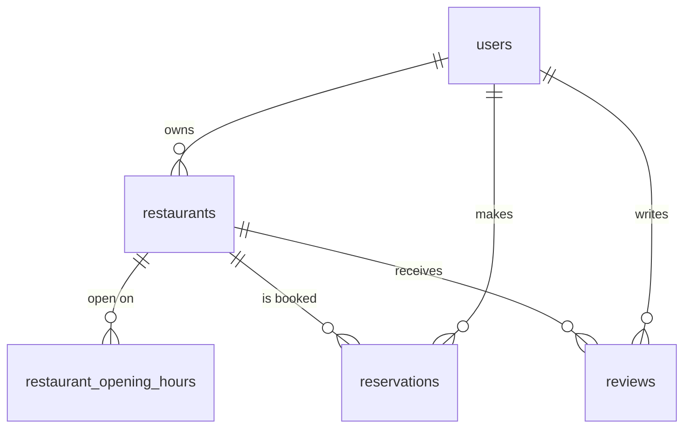

# Domain and data model

> ภาพรวมของทั้งระบบ (service, ล็อกอิน, frontend, คอนฟิก, ความปลอดภัย) อยู่ที่ [ARCHITECTURE.md](../../ARCHITECTURE.md) ที่ราก ไฟล์นี้เจาะเฉพาะข้อมูลและกฎของ API

The API follows the course project's layering: a feature package (`restaurant`, `reservation`, `review`)
holds its handler (HTTP only), service (rules, ownership), repository (GORM) and DTOs. Routes for the
three booking features are wired in `internal/httpapi`, which `cmd/api/main.go` and the tests share.

| Table | Notes |
| --- | --- |
| `users` | One row per Keycloak account, created at first sign-in. Both owner and customer. |
| `restaurants` | `owner_id`, `name`, `address`, `description`, `image_url`, `seating_capacity >= 1`, `cancellation_lead_minutes >= 30`. Soft delete (`deleted_at`). |
| `restaurant_opening_hours` | One row per open weekday (0 = Sunday), `open_time < close_time`. A weekday without a row is closed. Replaced as a set. |
| `reservations` | `[start_at, end_at)`, `guests >= 1`, `status` is `confirmed` or `cancelled`. Never deleted. |
| `reviews` | `rating` 1-5, non-blank `comment`, unique `(user_id, restaurant_id)`. Rating average and count are always computed from this table, never stored. |

Migrations (`api/migrations`, goose) are the only way the schema changes. The CHECK constraints repeat the
rules of the Go code as a last line of defence; the Go code is what produces the friendly errors.

## How bookings stay correct

- **One lock per restaurant.** Creating, changing or cancelling a reservation, and deleting a restaurant,
  all start with `SELECT ... FOR UPDATE` on the restaurant row (`reservation.repository.InTx`,
  `restaurant.repository.DeleteIfNoActiveReservations`). Requests for one restaurant therefore run one at a
  time and each sees the previous one's committed result; requests for other restaurants do not wait.
  Capacity and opening hours are read after the lock is held.
- **Capacity counts guests present at the same moment**, not the sum of every overlapping booking
  (`reservation.PeakGuests`, a pure function with its own tests): 10:00-12:00 and 12:00-14:00 do not add up
  against a candidate at 11:00-13:00. A reservation being changed does not count its own old seats.
- **Opening hours use Bangkok time (UTC+7).** Times are stored as `timestamptz`; before comparing them with
  the hours, they are converted to `Asia/Bangkok`, so a client may send any offset.
- **Lead time** (`reservation.leadTimeOK`) is one rule for both changing and cancelling, measured from the
  reservation's original start.
- **Reviews** rely on the database's unique key; a duplicate is recognised from PostgreSQL error 23505.

## Pictures

Uploaded files live in `UPLOAD_DIR` (`<dir>/restaurants/<id>-<uuid>.<ext>`), written through
`internal/storage`. The restaurant service chooses the name and the type (from the file content); the
files are served by Gin's static handler under `/api/v1/uploads`. In Docker the folder is a named volume
(`bookingtable-uploads`), created in the image owned by the non-root user so the API can write to it.

## Testing

Tests go through the HTTP router with the real service and repository and a real PostgreSQL container
(`internal/apitest`); `PeakGuests`, `leadTimeOK` and the file storage have plain unit tests. See
[TESTING.md](TESTING.md) and the repository README for how to run them.
