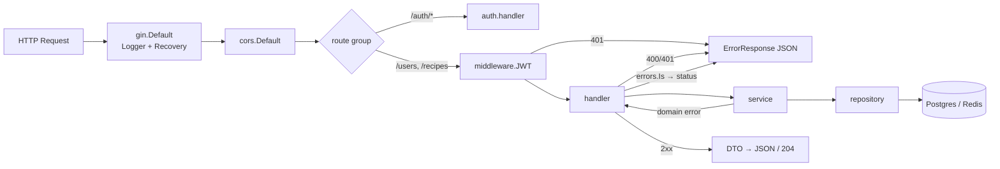
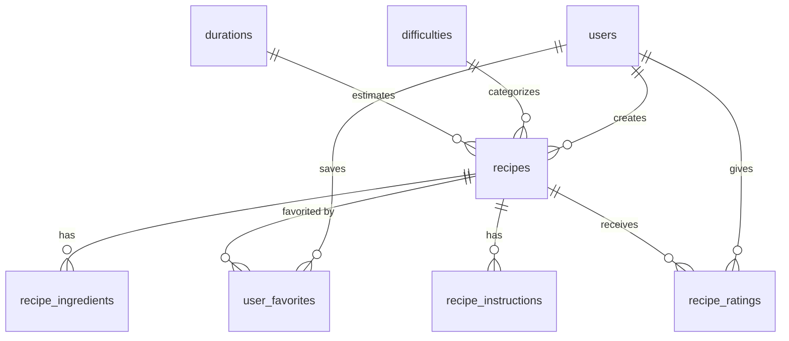

# Backend Architecture

> **เอกสารอ้างอิงจากคอร์ส** อธิบายโปรเจกต์ต้นแบบ `pea-wongnok` ที่โจทย์ให้อ่านก่อนทำ **ไม่ใช่แอป Booking Table นี้** (ชื่อ package, ตาราง, endpoint และรหัสผ่านตัวอย่างในนี้เป็นของต้นแบบ) ใช้เป็นธรรมเนียมการเขียนโค้ดเท่านั้น ของจริงของแอปนี้ดูที่ [api/docs](../../../api/docs/ARCHITECTURE.md) และ [README หลัก](../../../README.md)

> วิเคราะห์จาก `api/` (Go module `wongnok`) — ทุกข้ออ้างอิงมี path; สิ่งที่ยืนยันไม่ได้ระบุ **UNKNOWN**
> ไม่มีการเปิดเผยค่า secret · ไม่ได้รัน test/โปรแกรม (อ่านโค้ดอย่างเดียว)
> ภาพรวมระบบ: [SYSTEM_ARCHITECTURE.md](SYSTEM_ARCHITECTURE.md) · Frontend: [FRONTEND_ARCHITECTURE.md](FRONTEND_ARCHITECTURE.md)

---

## 1. Overview

Backend เป็น REST API เดียว (monolith) เขียนด้วย **Go + Gin** จัดโค้ดแบบ **feature package** ภายใต้ `internal/`
แต่ละ feature (`auth`, `user`, `recipe`) แบ่งชั้นเป็น:

```text
Route (main.go)
  → Middleware (JWT เฉพาะ group ที่ป้องกัน)
    → Handler   (HTTP: bind, อ่าน reqctx, map error → status)
      → Service (business rule, ownership check, orchestration)
        → Repository (GORM / Redis)
          → PostgreSQL / Redis
```

ลักษณะเด่น (ทุกข้อมีหลักฐานในหัวข้อถัดไป):
- **Consumer-side interface**: `handler.go` ประกาศ `Service` interface ที่ตนต้องใช้, `service.go` ประกาศ `Repository` interface — struct จริงเป็น unexported (`type handler struct`, `type service struct`, `type repository struct`) สร้างผ่าน `NewHandler/NewService/NewRepository`
- **DI ด้วยมือ** ใน `main.go` (ไม่มี DI framework)
- **DTO แยกจาก model**: `Request.ToX()` และ `NewXResponse()` อยู่ใน `dto.go`
- **Sentinel errors** ต่อ package + `errors.Is` ใน handler (ไม่มี error middleware กลาง)
- Authentication ที่ middleware, Authorization (ownership) ที่ service

---

## 2. Technology Stack

| Technology | Evidence | Purpose |
| --- | --- | --- |
| Go 1.26.4 | `api/go.mod`, `api/mise.toml` | ภาษา / toolchain |
| `gin-gonic/gin` v1.12.0 | `go.mod`, `cmd/api/main.go` | router, binding (`ShouldBindJSON/Query`), middleware |
| `gin-contrib/cors` v1.7.7 | `go.mod`, `main.go:114` | CORS |
| `gorm.io/gorm` v1.31.2 + `driver/postgres` | `go.mod`, `internal/platform/database/postgres.go` | ORM |
| `redis/go-redis/v9` | `go.mod`, `internal/platform/cache/redis.go` | Redis client |
| `coreos/go-oidc/v3`, `golang.org/x/oauth2` | `go.mod`, `internal/auth/service.go`, `middleware/jwt.go` | OIDC discovery, code exchange, token verify |
| `caarlos0/env/v11`, `go-playground/validator/v10`, `joho/godotenv` | `go.mod`, `internal/config/config.go` | config loading + validation |
| `google/uuid` | `go.mod` | UUID ของ `users.id` |
| `log/slog` | `main.go` (`newLogger`) | logging (JSON/text) |
| goose (CLI) | `api/AGENTS.md`, `migrations/*.sql` | migration |
| swaggo (`swag`, `gin-swagger`, `files`) | `go.mod`, `docs/docs.go`, `main.go` | Swagger UI ที่ `/swagger/*any` |
| testify, mockery (template `testify`), testcontainers-go | `go.mod`, `.mockery.yml`, `docs/TESTING.md` | testing |
| Validation: gin `binding:` tag (validator v10) | `internal/*/dto.go` | request validation |
| Message broker / Kafka | **UNKNOWN** — `Dockerfile` มี comment เรื่อง "Kafka TLS" แต่ไม่มี dependency/โค้ด Kafka (น่าจะเป็น comment จาก template) | — |

---

## 3. Application Entry Point

ไฟล์เดียว: **`api/cmd/api/main.go`** → `main()` เรียก `run()`; ถ้า error → `slog.Error` + `os.Exit(1)`

ลำดับใน `run()`:

| # | ขั้นตอน | โค้ด |
| --- | --- | --- |
| 1 | ตั้ง logger ชั่วคราว (text) | `newLogger(os.Stdout, "wongnok", …)` |
| 2 | โหลด+validate config | `config.Load()` (ถ้าพลาดพิมพ์ด้วย `config.Humanize`) |
| 3 | ตั้ง logger จริงจาก `cfg.Logging` | `slog.SetDefault` |
| 4 | Signal context (SIGINT/SIGTERM) | `signal.NotifyContext` |
| 5 | เปิด Postgres (+ ping) | `database.Open(ctx, cfg.Database.PostgresDSN, cfg.Logging)` — ถ้าพลาดใช้ `log.Fatal` |
| 6 | เปิด Redis (+ ping) | `cache.Open(ctx, cfg.Redis)` |
| 7 | OIDC discovery กับ Keycloak | `oidc.NewProvider(ctx, cfg.Keycloak.RealmURL())` → `Verifier(&oidc.Config{ClientID})` |
| 8 | **Dependency injection** | user → auth (รับ `userService`) → recipe |
| 9 | สร้าง router + CORS | `gin.Default()`, `cors.Default()` |
| 10 | ลงทะเบียน route (`/api/v1/...`) + swagger | ดู §6 |
| 11 | `http.Server` ฟัง `:8080` ใน goroutine | `ListenAndServe` |
| 12 | รอ signal → `Shutdown` ด้วย timeout `cfg.App.ShutdownTimeout` | graceful shutdown |

Swagger metadata (`@title`, `@BasePath /api/v1`, `@securityDefinitions.apikey BearerAuth`) อยู่เป็น comment บน `main()`

---

## 4. Directory Structure

```text
api/
├── cmd/api/main.go            # composition root
├── internal/
│   ├── auth/                  # Keycloak flow
│   │   ├── dto.go             # Exchange/Logout/RefreshToken request
│   │   ├── error.go           # ErrNotFound, ErrInvalidState, ErrInvalidTicket, …
│   │   ├── handler.go         # + interface Service
│   │   ├── model.go           # Credential, KeycloakClaims, keycloakTokenResponse
│   │   ├── repository.go      # Redis: state/ticket (SET / GETDEL)
│   │   ├── service.go         # + interfaces Repository, UserService; KeycloakDeps
│   │   └── mocks_test.go      # generated โดย mockery
│   ├── user/                  # dto, error, handler(+Service), model, repository, service(+Repository)
│   ├── recipe/                # เหมือน user + *_test.go ครบ (handler/service/dto/repository_integration)
│   ├── middleware/jwt.go      # + mocks_test.go (mock ของ UserResolver)
│   ├── reqctx/context.go      # typed context keys
│   ├── httputil/response.go   # ErrorResponse
│   ├── convutil/pointer.go    # ToSafeValue / ToPointer
│   ├── config/                # app, config, database, keycloak, logging, redis, humanize
│   └── platform/{database/postgres.go, cache/redis.go}
├── migrations/                # goose: 20260821150121 … 20260821150128 (8 ไฟล์)
├── docs/                      # API.md, ARCHITECTURE.md, TESTING.md, docs.go, swagger.json/yaml
├── Dockerfile, .dockerignore, .mockery.yml, mise.toml, AGENTS.md
└── .agents/, .claude/, skills-lock.json   # skill ของ AI assistant (ไม่เกี่ยวกับ runtime)
```

| ไฟล์ใน feature package | หน้าที่ |
| --- | --- |
| `handler.go` | HTTP เท่านั้น: อ่าน param/body, เรียก service, map error → status, ใส่ swagger annotation |
| `service.go` | กฎธุรกิจ, ตรวจสิทธิ์เจ้าของ, ประสานหลาย repository call |
| `repository.go` | เข้าถึงข้อมูล (GORM/Redis), แปลง error ของ driver → domain error |
| `model.go` | struct ที่ map ตาราง (GORM tag) |
| `dto.go` | request/response + mapper |
| `error.go` | sentinel errors ของ package |
| `mocks_test.go` | mock ที่ mockery สร้าง (`NewMockService`, `NewMockRepository`) |

---

## 5. Request Lifecycle



### Trace 1 — `POST /api/v1/recipes` (สร้างสูตร)

| ชั้น | ไฟล์ : สัญลักษณ์ | สิ่งที่เกิดขึ้น |
| --- | --- | --- |
| Route | `cmd/api/main.go:136` | `recipeGroup.POST("", recipeHandler.Create)` ภายใต้ `Use(middleware.JWT(...))` (บรรทัด 135) |
| Middleware | `internal/middleware/jwt.go` : `JWT` | ตรวจ `Authorization: Bearer`, `verifier.Verify`, `userResolver.ResolveID(sub)`, ใส่ `reqctx.WithSubject/WithUserID` ลง `ctx.Request` |
| Handler | `recipe/handler.go` : `(*handler).Create` | `reqctx.UserID` (ไม่มี→401) → `ShouldBindJSON(&CreateRecipeRequest)` (ผิด→400) → `service.Create(ctx, creatorID, req.ToRecipe())` |
| DTO | `recipe/dto.go` : `CreateRecipeRequest`, `ToRecipe()` | tag `binding:"required"`, `omitempty,url`, `required,dive`; แปลงเป็น `Recipe` |
| Service | `recipe/service.go` : `(*service).Create` | `repository.HasActiveReferences` → ถ้าไม่ผ่าน `ErrInvalidReferenceData`; ตั้ง `recipe.CreatorID`; เรียก `repository.Create` |
| Repository | `recipe/repository.go` : `(*repository).Create` | `db.Transaction`: insert `recipes` (`Omit(clause.Associations)`) → set `RecipeID` → insert `recipe_ingredients` → insert `recipe_instructions` |
| DB | ตาราง `recipes`, `recipe_ingredients`, `recipe_instructions` | `migrations/…124/125/126` |
| Response | `recipe/dto.go` : `NewCreateRecipeResponse` | `201 {"id": <int>}` |

### Trace 2 — `GET /api/v1/recipes?name=&difficulty=&favorite=&sort=&page=&limit=` (รายการ+กรอง)

| ชั้น | ไฟล์ : สัญลักษณ์ | สิ่งที่เกิดขึ้น |
| --- | --- | --- |
| Route | `main.go:137` | `recipeGroup.GET("", recipeHandler.GetRecipes)` |
| Handler | `recipe/handler.go` : `GetRecipes` | `ShouldBindQuery(&GetRecipesQuery)` (tag `form:`; `Pagination` embedded; `favorite` เป็น `*bool` → 3 สถานะ: ไม่ส่ง/true/false) → `service.List` |
| Service | `recipe/service.go` : `List` | `query.Ensure()` (default page=1, limit=12 (max 100), sort=DESC) → ถ้ามี `difficulty` ตรวจ `DifficultyExists` → `repository.List` |
| Repository | `recipe/repository.go` : `List` | `ILIKE` ชื่อ, filter difficulty, sub-query `user_favorites`, `Count`, `Preload` 5 relation, `Order`, `Limit`; จากนั้น query เสริม `favoritedRecipeIDs` และ `ratingTotals` แล้วเติมค่าลง field `gorm:"-"` (`IsFavorite`, `RatingTotal`) |
| Response | `recipe/dto.go` : `NewListRecipesResponse` | `200 {"total": n, "results": [RecipeResponse…]}` (`ListResponse[T]` generic) |

> ข้อสังเกต: `recipe/repository.go:267` ใช้ `db.Order((query.Page - 1) * query.Limit).Limit(query.Limit)` — ดูเหมือนตั้งใจใช้ `Offset` (**needs manual verification** ว่า page ≥ 2 ได้ผลถูกไหม)

### Trace 3 — `PUT /api/v1/users/me` (แก้โปรไฟล์)

| ชั้น | ไฟล์ : สัญลักษณ์ | สิ่งที่เกิดขึ้น |
| --- | --- | --- |
| Route | `main.go:131` | `userGroup.PUT("/:id", userHandler.UpdateUser)` (JWT) |
| Handler | `user/handler.go` : `UpdateUser` | `id != "me"` → 404; `reqctx.UserID`; `ShouldBindJSON(&UpdateUserRequest)` (`imageUrl` เป็น `omitempty,url`) → `service.Update(ctx, uid, req.ToUser())` |
| Service | `user/service.go` : `Update` | `FindByID` → แก้เฉพาะ `ImageURL`, `Bio` (name/email มาจาก Keycloak แก้ไม่ได้) → `repository.Update` |
| Repository | `user/repository.go` : `FindByID`, `Update` | `First(&result, id)` → map `gorm.ErrRecordNotFound` → `ErrUserNotFound`; `Save` |
| Response | `user/dto.go` : `NewUserResponse` | `200 UserResponse` |

---

## 6. Routes

ลงทะเบียนทั้งหมดใน `cmd/api/main.go:117-143` (+ swagger ที่ `router.GET("swagger/*any", …)`). Base path `/api/v1`.

| Method | Path | Handler | JWT | หมายเหตุ |
| --- | --- | --- | --- | --- |
| GET | `/auth/login` | `auth.Login` | ✗ | 302 → Keycloak |
| GET | `/auth/callback` | `auth.Callback` | ✗ | Keycloak redirect มาเอง |
| POST | `/auth/exchange` | `auth.Exchange` | ✗ | ticket → Credential |
| POST | `/auth/logout` | `auth.Logout` | ✗ | ใช้ refreshToken ใน body |
| POST | `/auth/refresh-token` | `auth.RefreshToken` | ✗ | |
| GET | `/users/:id` | `user.GetUser` | ✓ | รับเฉพาะ `me` |
| PUT | `/users/:id` | `user.UpdateUser` | ✓ | รับเฉพาะ `me` |
| POST | `/recipes` | `recipe.Create` | ✓ | 201 |
| GET | `/recipes` | `recipe.GetRecipes` | ✓ | query filter + pagination |
| GET | `/recipes/:id` | `recipe.GetRecipe` | ✓ | |
| PUT | `/recipes/:id` | `recipe.Replace` | ✓ | เจ้าของเท่านั้น |
| DELETE | `/recipes/:id` | `recipe.Delete` | ✓ | soft delete, เจ้าของเท่านั้น |
| POST | `/recipes/:id/favorite` | `recipe.Favorite` | ✓ | 204, idempotent |
| DELETE | `/recipes/:id/favorite` | `recipe.Unfavorite` | ✓ | 204, hard delete |
| POST | `/recipes/:id/rating` | `recipe.Rate` | ✓ | 204, ให้คะแนนได้ครั้งเดียว |
| GET | `/swagger/*any` | gin-swagger | ✗ | |

**ยังไม่มี route:** `GET /difficulties`, `GET /durations` (มีใน `docs/API.md` เป็น contract เท่านั้น)

รูปแบบการจัดกลุ่ม: `v1 := router.Group("/api/v1")` → `v1.Group("/<resource>")` → `.Use(middleware.JWT(...))` ที่ระดับ group (ไม่ใช่ทีละ route)

---

## 7. Controllers / Handlers

- ที่: `internal/<feature>/handler.go`; ชื่อ method เป็นกริยา (`Create`, `GetRecipes`, `Replace`, `Favorite`)
- ทุก handler มีรูปแบบซ้ำ (เห็นใน `recipe/handler.go` ทั้ง 8 method):
  1. `reqctx.UserID(ctx.Request.Context())` — ไม่ ok → `401 "unauthorized"`
  2. parse path param (`strconv.Atoi(ctx.Param("id"))` → 400) / bind body (`ShouldBindJSON` → 400) / bind query (`ShouldBindQuery`)
  3. เรียก `hdr.service.X(ctx.Request.Context(), …)`
  4. `switch { case errors.Is(err, ErrX): … default: 500 }`
  5. สำเร็จ: `ctx.JSON(200/201, NewXResponse(...))` หรือ `ctx.Status(204)`
- ใช้ `ctx.AbortWithStatusJSON` เป็นหลัก (บางที่ใช้ `ctx.JSON` — ไม่สม่ำเสมอใน `user/handler.go`, `GetRecipes` กรณี 400)
- Swagger annotation (`// X godoc … @Router`) ติดทุก handler เป็นภาษาไทย
- ส่ง `ctx.Request.Context()` ลง service (ไม่ส่ง `*gin.Context`) — ยกเว้น `user.GetUser` ที่ส่ง `ctx` (gin.Context implements `context.Context`) ตรงๆ ใน `hdr.service.FindByID(ctx, uid)`

---

## 8. Services

- ที่: `internal/<feature>/service.go`; type `service` unexported, สร้างด้วย `NewService(repo Repository)`
- ประกาศ `Repository` interface ในไฟล์เดียวกัน (เฉพาะ method ที่ service ใช้)
- หน้าที่จริงที่เห็น:
  - **Business validation**: `recipe.Create/Replace` เรียก `HasActiveReferences` → `ErrInvalidReferenceData` / `ErrReferenceDataUnavailable`
  - **Ownership authorization**: `recipe.Replace/Delete` โหลด `existing` ก่อน แล้วเทียบ `existing.CreatorID != userID` → `ErrForbidden`
  - **Defaults**: `recipe.List` เรียก `query.Ensure()`
  - **Composition**: `recipe.Get` = `FindByID` + `IsFavorite`
  - **Cross-feature**: `auth.service` ถือ `UserService` interface (ของตัวเอง) เพื่อเรียก `UpsertFromKeycloak`; `user.service` ใช้เป็น `UserResolver` ของ middleware ผ่าน `ResolveID`
- การจัดการ error: `fmt.Errorf("replace recipe: %w", err)` — wrap เสมอ ยกเว้นส่ง sentinel ตรงๆ (`return nil, ErrForbidden`)
- service ฝั่ง `auth` ทำ HTTP call ไป Keycloak เองด้วย `http.Client{Timeout: 10s}` (`Logout`, `RefreshToken`) — ไม่แยก adapter

---

## 9. Repository / Data Access

- ที่: `internal/<feature>/repository.go`; type `repository` unexported; `NewRepository(db *gorm.DB[, cache *redis.Client])`
- ทุก query ใช้ `repo.db.WithContext(ctx)` (สม่ำเสมอ)
- **แปลง error ของ driver → domain error** ใน repository: `gorm.ErrRecordNotFound` → `ErrUserNotFound` / `ErrRecipeNotFound`; `redis.Nil` → `auth.ErrNotFound`
- Pattern ที่ใช้ใน `recipe/repository.go`:

| Pattern | ตัวอย่าง |
| --- | --- |
| Transaction | `Create`, `Replace`, `Rate` ใช้ `db.Transaction(func(tx *gorm.DB) error {…})` |
| `Omit(clause.Associations)` | กัน GORM insert relation ซ้ำตอน `Create` |
| Replace children = ลบทั้งหมดแล้วสร้างใหม่ | `Replace` ลบ ingredients/instructions แล้ว insert ใหม่ (reset `ID = 0`) |
| Upsert | `Favorite` → `clause.OnConflict{… DoUpdates deleted_at=nil}` |
| Hard delete บนตารางที่ปกติ soft delete | `Unfavorite` ใช้ `.Unscoped().Delete` |
| Preload | `FindByID`, `List` → `Difficulty, Duration, Creator, Ingredients, Instructions` |
| คำนวณฟิลด์เสริม | `RatingTotal`, `IsFavorite` (tag `gorm:"-"`) เติมด้วย query แยก (`ratingTotals`, `favoritedRecipeIDs`) |
| Idempotent rate | `Rate` — ถ้ามีคะแนนอยู่แล้วคืน nil เฉยๆ; ไม่งั้น insert แล้วคำนวณ `AVG(score)` เขียนลง `recipes.average_rating` ใน transaction เดียว |

- `auth/repository.go` ใช้ Redis: `SET key val TTL` และ `GETDEL` (อ่านแล้วลบ atomically)
- `user/repository.go` : `ResolveID(uid)` → cache key `user_resolve_id:<sub>` (TTL 24 ชม.) — **เงื่อนไขอ่าน cache กลับด้าน (`repository.go:65`) cache จึงไม่ถูกใช้ตอนอ่าน**

---

## 10. Database

- PostgreSQL 17 (`compose.yml`); เปิดด้วย `database.Open` (`internal/platform/database/postgres.go`): `gorm.Open(postgres.Open(dsn), Logger by LOG_LEVEL)` → `db.DB()` → `PingContext`
- `Logging.GormLogLevel()` แมป `DEBUG→Info`, `WARN`, `ERROR`, อื่นๆ→`Warn`
- **Migration:** goose, ไฟล์ `api/migrations/<timestamp>_<name>.sql` มี `-- +goose Up/Down`
  - สร้างด้วย `goose create <name> sql` (`api/AGENTS.md`); config ผ่าน `GOOSE_MIGRATION_DIR`, `GOOSE_DRIVER`, `GOOSE_DBSTRING` ใน `.env`
  - **ไม่มี AutoMigrate** (ตรวจแล้วไม่พบใน `api/**/*.go`) และไม่ถูกเรียกอัตโนมัติจาก compose/main
  - Seed master data อยู่ใน migration (`…122_create_difficulties.sql`, `…123_create_durations.sql`)
- ลำดับ migration: users → difficulties → durations → recipes → recipe_ingredients → recipe_instructions → user_favorites → recipe_ratings
- Redis: ดู §9 (state/ticket/user-id cache)

---

## 11. Models / Entities

ER (จาก `migrations/*.sql` และ `api/docs/ARCHITECTURE.md`):



| Go type | ไฟล์ | ตาราง | จุดสังเกต |
| --- | --- | --- | --- |
| `user.User` | `user/model.go` | `users` | PK `uuid` (`default:gen_random_uuid()` ใน tag; migration ไม่มี DEFAULT → service สร้าง `uuid.New()` เอง); `UID` = Keycloak `sub` (unique index); ฟิลด์ optional เป็น pointer |
| `recipe.Recipe` | `recipe/model.go` | `recipes` | PK `serial int`; relation `Difficulty/Duration/Creator/Ingredients/Instructions`; `IsFavorite`, `RatingTotal` = `gorm:"-"` (ไม่มีในตาราง) |
| `RecipeIngredient`, `RecipeInstruction` | `recipe/model.go` | `recipe_ingredients`, `recipe_instructions` | FK `recipe_id` |
| `Difficulty`, `Duration` | `recipe/model.go` | `difficulties`, `durations` | PK string (`easy`, `30m` …) เป็น reference data |
| `UserFavorite`, `RecipeRating` | `recipe/model.go` | `user_favorites`, `recipe_ratings` | composite PK `(user_id, recipe_id)` |
| `auth.Credential`, `KeycloakClaims`, `keycloakTokenResponse` | `auth/model.go` | — (ไม่เก็บ DB; Credential อยู่ใน Redis ชั่วคราว) | |

ทุกตารางมี `created_at/updated_at` และ `deleted_at` → ทุก model มี `gorm.DeletedAt` (soft delete อัตโนมัติ ยกเว้น `Unscoped`)
ชื่อตาราง: GORM naming convention (`Recipe` → `recipes`) ไม่ต้องระบุ `TableName()` (ไม่พบในโค้ด)

---

## 12. Validation

สองระดับ:

| ระดับ | กลไก | ตัวอย่าง |
| --- | --- | --- |
| Transport (รูปแบบข้อมูล) | gin `binding:` tag บน DTO + `ShouldBindJSON/ShouldBindQuery` | `required`, `omitempty,url`, `required,dive`, `min=1,max=5` (`RateRecipeRequest`), `oneof=ASC DESC`, `min=1,max=100` (`Pagination`), `email` |
| Business | ใน service | ตรวจ difficulty/duration มีอยู่จริง, ตรวจเจ้าของสูตร |
| Defaults | method `Ensure()` บน query/pagination/sort | `Pagination.Ensure`, `SortDirection.Ensure`, `GetRecipesQuery.Ensure` |
| Config | `validator.New(WithRequiredStructEnabled())` + `Validate()` ต่อ struct | `config/config.go` (+ `Database.Validate` ตรวจชื่อ DB ใน DSN) |

หมายเหตุ: slice ใน `CreateRecipeRequest` ใช้ pointer-to-slice (`*[]…`) เพื่อแยก "ไม่ส่ง" (→ 400 จาก `required`) ออกจาก "ส่ง `[]`" (ผ่าน) — มี test `TestCreateRecipeRequestAllowsExplicitEmptyChildCollections` (`recipe/dto_test.go`)

---

## 13. Authentication

ภาพรวมแบบ sequence ดู [SYSTEM_ARCHITECTURE.md §6](SYSTEM_ARCHITECTURE.md). ส่วนที่เป็นโค้ด backend:

**(ก) Login flow** — package `internal/auth` (5 endpoint, ดู §6 ตารางด้านบน)
- Config ของ OAuth2: `oauth2.Config{ClientID, ClientSecret, RedirectURL, Endpoint: provider.Endpoint(), Scopes: openid, profile, email}` ใน `auth.NewService`
- ใช้ `KeycloakDeps{Config, Provider, Verifier}` เป็น struct รวม dependency ของ Keycloak
- State/ticket: สุ่ม 32 byte (`crypto/rand`) → base64url (`generateRandomToken`); เก็บ Redis; ใช้ครั้งเดียว (`GETDEL`)

**(ข) ตรวจ token ทุก request** — `internal/middleware/jwt.go`

```text
Authorization: Bearer <token>
  ├─ ไม่ขึ้นต้น "Bearer "           → 401 {"message":"missing token"}
  ├─ verifier.Verify(...) ล้มเหลว     → 401 {"message":"invalid token"}   (ตรวจ signature/iss/aud/exp ด้วย JWKS จาก discovery)
  ├─ userResolver.ResolveID(sub) ล้ม → 401 {"message":"user not found"}   (⚠ ไม่มี return — jwt.go:39)
  └─ ctx.Request = ctx.Request.WithContext(reqctx.WithUserID(reqctx.WithSubject(...)))
```

- ใช้ `oidc.IDTokenVerifier` กับ **access token** (ไม่ใช่ id_token) โดยตั้ง `ClientID = "wongnok"`; ผ่านได้เพราะ Keycloak มี audience mapper `wongnok-audience` (`keycloak/import/pea-realm.json`)
- `UserResolver` เป็น interface เล็กๆ ที่ middleware ประกาศเอง → `user.service` implement
- Handler ไม่เห็น token — เห็นแค่ `reqctx.UserID(ctx.Request.Context())` (UUID ภายใน)

**(ค) Provisioning ผู้ใช้:** `user.service.UpsertFromKeycloak` ถูกเรียกตอน `HandleCallback` — user ใหม่ที่ยังไม่เคย login ผ่าน flow นี้จะไม่มีแถวใน `users` (middleware ตอบ 401 "user not found")

---

## 14. Authorization

- **ไม่มี role/permission/scope check** ในโค้ด และ realm ก็ไม่มี custom role (`pea-realm.json`)
- มีเพียง **resource ownership** ใน service:

| กรณี | ที่ | ผลลัพธ์ |
| --- | --- | --- |
| แก้สูตร | `recipe/service.go` `Replace` : `existing.CreatorID != userID` | `ErrForbidden` → handler 403 |
| ลบสูตร | `recipe/service.go` `Delete` | เช่นเดียวกัน |
| ดู/แก้โปรไฟล์ | `user/handler.go` | รับเฉพาะ `:id = me` และใช้ `userID` จาก context — ไม่มีทางแก้ของคนอื่น |
| Favorite/Rate | ใช้ `userID` จาก context เสมอ | ไม่รับ user id จาก client |

- Pattern ที่ใช้ซ้ำ: **อย่ารับ user id จาก client — อ่านจาก `reqctx`**
- ถ้า Final Project ต้องมี role (admin/user): ไม่มีตัวอย่างใน repo — **UNKNOWN** ว่าจะอ่าน role จาก token ที่ไหน (ต้องเพิ่มเอง; `JWT` ปัจจุบันใช้เฉพาะ `Subject`)

---

## 15. Error Handling

Flow: **Repository** (แปลง driver error → sentinel) → **Service** (wrap `%w`) → **Handler** (`errors.Is` → HTTP status)

รูปแบบ response error: `httputil.ErrorResponse{Message, Code}` → `{"message":"…"}` (`code` ไม่มีที่ไหนกำหนดค่า)

| Sentinel error | ที่ประกาศ | HTTP ที่ handler ตอบ |
| --- | --- | --- |
| `recipe.ErrRecipeNotFound` | `recipe/error.go` | 404 `"recipe not found"` (Get/Replace/Delete) |
| `recipe.ErrReferenceDataUnavailable` | " | 404 (Replace) |
| `recipe.ErrInvalidReferenceData` | " | 400 `"invalid request"` (Create/List) |
| `recipe.ErrForbidden` | " | 403 `"forbidden"` (Replace/Delete) |
| `user.ErrUserNotFound` | `user/error.go` | 404 (ข้อความ = `err.Error()`) |
| `user.ErrInvalidInput` | " | 400 |
| `auth.ErrInvalidState` | `auth/error.go` | 401 (Callback) |
| `auth.ErrInvalidTicket` | " | 401 (Exchange) |
| `auth.ErrInvalidRefreshToken` | " | 401 (RefreshToken) |
| `auth.ErrLogoutFailed`, อื่นๆ ใน Callback | " | 502 (Logout, Callback) |
| ไม่รู้จัก | — | 500 (`"internal server error"` ใน recipe; `err.Error()` ใน user) |
| bind/parse ผิด | — | 400 (`"invalid request"`; auth/GetRecipes ส่ง `err.Error()`) |

- **ไม่มี** error-handling middleware กลาง; `gin.Default()` ให้ Recovery (panic → 500) เท่านั้น
- ไม่มี custom error type (ไม่มี `errors.As` ที่ใช้กับ type ของโดเมน) — ใช้ sentinel + `errors.Is`
- Startup error: config ผิด → `config.Humanize(err)` พิมพ์รายการข้อผิดพลาดแบบอ่านง่าย

---

## 16. Environment Configuration

กลไก: `env.ParseAs[Config]()` (`caarlos0/env`) → struct ซ้อน `Config{App, Database, Redis, Keycloak, Logging}` → `cfg.Validate()` รวม error ด้วย `errors.Join`
`godotenv/autoload` โหลด `.env` ถ้ามี (ไม่บังคับ). ตารางตัวแปรทั้งหมด (ชื่อ/default/หมายเหตุ) อยู่ใน [SYSTEM_ARCHITECTURE.md §9](SYSTEM_ARCHITECTURE.md)

Pattern ที่ใช้ซ้ำ: **หนึ่ง struct ต่อหนึ่ง concern** + tag `env`, `envDefault`, `validate` + method `Validate()` และ helper (`Addr()`, `RealmURL()`, `IsProduction()`, `SlogLevel()`)

⚠ `APP_PORT` ถูกโหลดและ validate แต่ `main.go:150` hardcode `":8080"`

---

## 17. API Conventions

จาก `api/docs/API.md` + โค้ด:

| หัวข้อ | Convention |
| --- | --- |
| Base path / version | `/api/v1` |
| Auth | `Authorization: Bearer <access-token>` ทุก endpoint ยกเว้น `/auth/*` |
| Content type | `application/json` |
| ชื่อ field JSON | camelCase (`imageUrl`, `difficultyId`, `createdAt`) |
| เวลา | RFC 3339 |
| ชื่อ resource | พหูพจน์ (`/recipes`, `/users`) ; sub-resource แบบ `/recipes/:id/favorite`, `/recipes/:id/rating` |
| ID | recipe/ingredient/instruction = integer; user = UUID string; reference data = string id (`easy`) |
| Methods | `POST` สร้าง (201), `GET` อ่าน, `PUT` = **แทนที่ทั้งก้อน** (`Replace`, ไม่มี PATCH), `DELETE` (204) |
| Action ที่ไม่มี body ตอบ | 204 No Content (`favorite`, `unfavorite`, `rating`, `delete`, `logout`) |
| List | `{"total": n, "results": […]}` + query `page` (default 1), `limit` (default 12, max 100), `sort=ASC|DESC` (ตาม `created_at`) |
| Filter | query string (`name`, `difficulty`, `favorite=true|false`) |
| Error | `{"message": "..."}`; ยึด HTTP status เป็นหลัก |
| Self-reference | `/users/me` |
| เอกสาร | Swagger (generated, เฉพาะ route ที่ implement) + `docs/API.md` (เขียนมือ, รวม contract ที่ยังไม่ทำ) |

---

## 18. End-to-End Endpoint Examples

### 18.1 `POST /recipes/:id/rating`

```text
main.go:143  recipeGroup.POST("/:id/rating", recipeHandler.Rate)
  → middleware.JWT                      (ตั้ง UserID)
  → recipe.handler.Rate                 Atoi(id) | ShouldBindJSON(RateRecipeRequest{rating 1..5}) | 204
  → recipe.service.Rate                 float64(rating) → repository.Rate
  → recipe.repository.Rate              Transaction:
        COUNT(user_id, recipe_id) > 0 → return nil (ไม่ทำซ้ำ)
        INSERT recipe_ratings
        SELECT COALESCE(AVG(score),0) WHERE recipe_id
        UPDATE recipes SET average_rating
  → DB: recipe_ratings, recipes
```

### 18.2 `DELETE /recipes/:id` (มี authorization)

```text
recipe.handler.Delete
  → recipe.service.Delete   FindByID (ไม่เจอ → ErrRecipeNotFound→404)
                            existing.CreatorID != userID → ErrForbidden→403
                            repository.Delete
  → recipe.repository.Delete  db.Delete(&Recipe{}, id)   (soft delete เพราะมี gorm.DeletedAt)
                              RowsAffected == 0 → ErrRecipeNotFound
  → 204
```

### 18.3 `POST /auth/refresh-token`

```text
auth.handler.RefreshToken  ShouldBindJSON(RefreshTokenRequest) → service.RefreshToken
auth.service.RefreshToken  POST {realm}/protocol/openid-connect/token  (form: grant_type=refresh_token, client_id, client_secret, refresh_token)
                           status != 200 → ErrInvalidRefreshToken → 401
                           decode keycloakTokenResponse → Credential{ExpiresAt = now + expires_in}
→ 200 Credential
```

---

## 19. Backend Architecture Rules

```text
BACKEND-RULE-01  จัดโค้ดเป็น feature package; หนึ่ง package = handler/service/repository/model/dto/error ครบในที่เดียว
Evidence: internal/{auth,user,recipe}/ มีไฟล์ชุดเดียวกัน
Implementation: Route → Handler → Service → Repository

BACKEND-RULE-02  Handler ทำเฉพาะเรื่อง HTTP; business rule อยู่ใน Service
Evidence: recipe/handler.go (bind/map error) เทียบ recipe/service.go (ownership, reference check)

BACKEND-RULE-03  interface ถูกประกาศฝั่งผู้ใช้ (consumer) และ struct จริงเป็น unexported + NewX()
Evidence: handler.go `type Service interface`, service.go `type Repository interface`, middleware/jwt.go `UserResolver`, auth/service.go `UserService`

BACKEND-RULE-04  Wiring ทั้งหมดอยู่ที่ composition root เดียว (main.go) — ไม่มี global/singleton
Evidence: cmd/api/main.go ส่วน "Dependency injection"

BACKEND-RULE-05  ทุก repository method รับ ctx แรกสุดและใช้ db.WithContext(ctx)
Evidence: user/repository.go, recipe/repository.go

BACKEND-RULE-06  Repository แปลง error ของ driver เป็น domain sentinel; Service wrap ด้วย %w; Handler map ด้วย errors.Is
Evidence: user/repository.go FindByID (ErrRecordNotFound→ErrUserNotFound), recipe/service.go, recipe/handler.go

BACKEND-RULE-07  Request/Response เป็น DTO แยกจาก model; mapper อยู่ใน dto.go (ToX / NewXResponse)
Evidence: recipe/dto.go, user/dto.go

BACKEND-RULE-08  ไม่รับ user id จาก client; อ่านตัวตนจาก reqctx ที่ middleware ใส่ไว้
Evidence: ทุก handler ใน recipe/ และ user/ เรียก reqctx.UserID

BACKEND-RULE-09  การเขียนหลายตาราง = transaction ใน repository
Evidence: recipe/repository.go Create/Replace/Rate

BACKEND-RULE-10  Schema เปลี่ยนด้วย goose migration เท่านั้น; ทุกตารางมี created_at/updated_at/deleted_at (soft delete)
Evidence: migrations/*.sql, models ที่มี gorm.DeletedAt

BACKEND-RULE-11  Config: หนึ่ง struct ต่อ concern, env tag + validate tag + Validate()
Evidence: internal/config/*.go

BACKEND-RULE-12  Test แยกตามชั้น: handler (mock Service), service (mock Repository), repository (testcontainers Postgres จริง), dto
Evidence: recipe/{handler,service,dto,repository_integration}_test.go, docs/TESTING.md; mock สร้างด้วย mockery เท่านั้น

BACKEND-RULE-13  ทุก handler มี swagger annotation; contract เขียนมือใน docs/API.md
Evidence: handler.go ทุกไฟล์, api/docs/API.md
```

> กฎ 02, 06 มีข้อยกเว้นในโค้ด (เช่น `user/handler.go` ส่ง `err.Error()` ออก client) — ดูข้อสังเกตที่ SYSTEM_ARCHITECTURE §15

---

## 20. How to Add a New API Feature

ตัวอย่างสมมติ: เพิ่ม resource `comments` (ลำดับอนุมานจากโครงของ `recipe/` — เป็นขั้นตอนที่ repo ใช้จริง ไม่ใช่การออกแบบใหม่)

```text
1. Migration (goose)      cd api && goose create create_comments sql
        ↓                 เขียน Up/Down + index + deleted_at ตามแบบ migrations/…124_create_recipes.sql
2. Model                  internal/comment/model.go   (GORM struct; ใส่ gorm.DeletedAt)
        ↓
3. Errors                 internal/comment/error.go   (sentinel: ErrCommentNotFound, ErrForbidden …)
        ↓
4. DTO                    internal/comment/dto.go     (XxxRequest + binding tag, ToComment(), NewCommentResponse())
        ↓
5. Repository             internal/comment/repository.go
        │                 type repository struct{db *gorm.DB}; NewRepository(db)
        │                 ใช้ WithContext(ctx), แปลง ErrRecordNotFound → ErrCommentNotFound, Transaction เมื่อเขียนหลายตาราง
        ↓
6. Service                internal/comment/service.go
        │                 ประกาศ interface Repository (เฉพาะ method ที่ใช้) ; ใส่ business rule + ownership check
        ↓
7. Handler                internal/comment/handler.go
        │                 ประกาศ interface Service ; reqctx.UserID → bind → service → errors.Is → status
        │                 เขียน swagger annotation ทุก method
        ↓
8. Wire & route           cmd/api/main.go
        │                 repo := comment.NewRepository(db); svc := comment.NewService(repo); h := comment.NewHandler(svc)
        │                 g := v1.Group("/comments"); g.Use(middleware.JWT(oidcVerifer, userService)); g.POST("", h.Create) …
        ↓
9. Mocks + tests          รัน mockery (config: api/.mockery.yml → สร้าง mocks_test.go)
        │                 handler_test (mock Service), service_test (mock Repository),
        │                 repository_integration_test (testcontainers), dto_test
        ↓
10. Docs                  อัปเดต api/docs/API.md (และ regenerate swagger — คำสั่ง UNKNOWN, ดู SYSTEM §16)
```

ข้อควรจำ:
- ถ้าเพิ่ม field ที่ frontend ต้องใช้ ให้แก้ DTO + `docs/API.md` พร้อมกัน เพราะ frontend ยังไม่มีโค้ดให้ตามแก้
- ตารางที่มีความสัมพันธ์กับ `users` ให้ FK ไป `users.id` (UUID) ไม่ใช่ Keycloak `sub`
- Integration test สร้างสคีมาจาก migration จริง: `writeMigrationScript` ใน `recipe/repository_integration_test.go` glob `../../migrations/*.sql`, ตัดเอาเฉพาะส่วน `-- +goose Up` แล้วใส่เป็น init script ของ container Postgres → migration ใหม่ถูกใช้ใน test อัตโนมัติ (ต้องเขียน `Up` ให้รันได้โดยไม่ต้องพึ่ง goose)
- สั่ง `go test ./...` ต้องมี Docker เพราะ integration test ใช้ testcontainers (ไม่ได้รันยืนยัน)

---

## 21. Important Files

| ไฟล์ | บทบาท |
| --- | --- |
| `cmd/api/main.go` | composition root + routes |
| `internal/recipe/{handler,service,repository}.go` | ต้นแบบ feature ที่ครบที่สุด |
| `internal/recipe/dto.go` | ต้นแบบ DTO, pagination, generic `ListResponse[T]` |
| `internal/recipe/repository.go` | ตัวอย่าง transaction / upsert / preload / sub-query |
| `internal/auth/service.go` | login flow, refresh, logout |
| `internal/middleware/jwt.go` | authentication |
| `internal/reqctx/context.go` | typed context |
| `internal/config/*.go` | config pattern |
| `internal/platform/database/postgres.go` | เปิด DB |
| `migrations/*.sql` | schema |
| `.mockery.yml` | วิธีสร้าง mock |
| `docs/API.md` | API contract |
| `docs/ARCHITECTURE.md` | ER + กติกาโดเมน |
| `docs/TESTING.md` | แนวทางเขียน test |
| `Dockerfile` | multi-stage build → distroless |

---

## 22. Reusable Patterns

| Pattern | คัดลอกจาก | ใช้เมื่อ |
| --- | --- | --- |
| Feature package template | `internal/recipe/` | ทุก resource ใหม่ |
| Config struct + Validate + Humanize | `internal/config/` | โปรเจกต์ใหม่ทุกโปรเจกต์ |
| `platform/` สำหรับเปิด connection | `internal/platform/` | ต่อ DB/cache |
| `reqctx` typed keys | `internal/reqctx/` | ส่ง identity ผ่าน context |
| JWT middleware ที่รับ interface resolver | `internal/middleware/jwt.go` | ป้องกัน route ด้วย Keycloak |
| One-time ticket via Redis `GETDEL` | `internal/auth/` | ส่งต่อ credential จาก backend ไป SPA โดยไม่ใส่ token ใน URL |
| Upsert user ตอน login | `user.UpsertFromKeycloak` | sync ผู้ใช้จาก IdP |
| Idempotent action (favorite/rate) | `recipe/repository.go` | toggle/like |
| Generic list response | `recipe/dto.go` `ListResponse[T]` | list endpoint ทุกตัว |
| Pointer helper | `internal/convutil` | field optional ↔ non-pointer |
| Graceful shutdown + signal ctx | `main.go` | service ทุกตัว |
| Test trio: mock handler / mock service / testcontainers repo | `recipe/*_test.go` | ทุก feature |

---

## 23. Unknowns

| หัวข้อ | สถานะ |
| --- | --- |
| ผลรัน `go test ./...` / ความครอบคลุม test ของ `auth`, `middleware` | UNKNOWN — ไม่ได้รัน (พบ `mocks_test.go` ใน `auth/`, `middleware/` แต่ไม่พบ `*_test.go` ที่ใช้งาน mock เหล่านั้น) |
| วิธีรัน/ติดตั้ง goose ของผู้สอน (เวอร์ชัน, คำสั่ง up) | UNKNOWN — มีเฉพาะ `goose create` ใน `AGENTS.md` |
| คำสั่ง regenerate Swagger (`swag init …`) | UNKNOWN |
| ผล pagination ของ `GET /recipes` เมื่อ page > 1 | UNKNOWN — needs manual verification (`repository.go:267`) |
| CORS preflight กับ header `Authorization` จาก browser | UNKNOWN — needs manual verification (ดูข้อ 7 ใน SYSTEM §15) |
| Production config (`APP_ENV=production`) พฤติกรรมจริง | UNKNOWN — โค้ดมีเพียง `gin.SetMode` หลัง `gin.Default()` |
| การจัดการ role/permission | UNKNOWN — ไม่มีในโค้ด |
| Rate limiting, request ID, metrics, tracing | UNKNOWN — ไม่พบในโค้ด (`go.mod` มี OpenTelemetry เป็น indirect dependency เท่านั้น) |
| การ seed ข้อมูล user/recipe ตัวอย่าง | UNKNOWN — มี seed เฉพาะ difficulties/durations |
