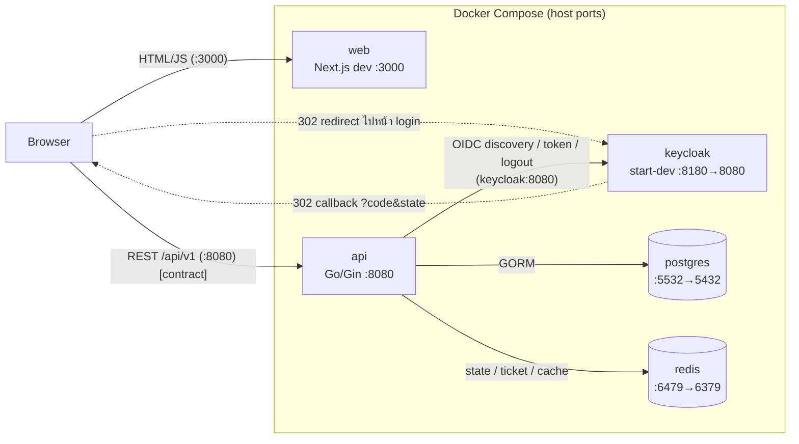
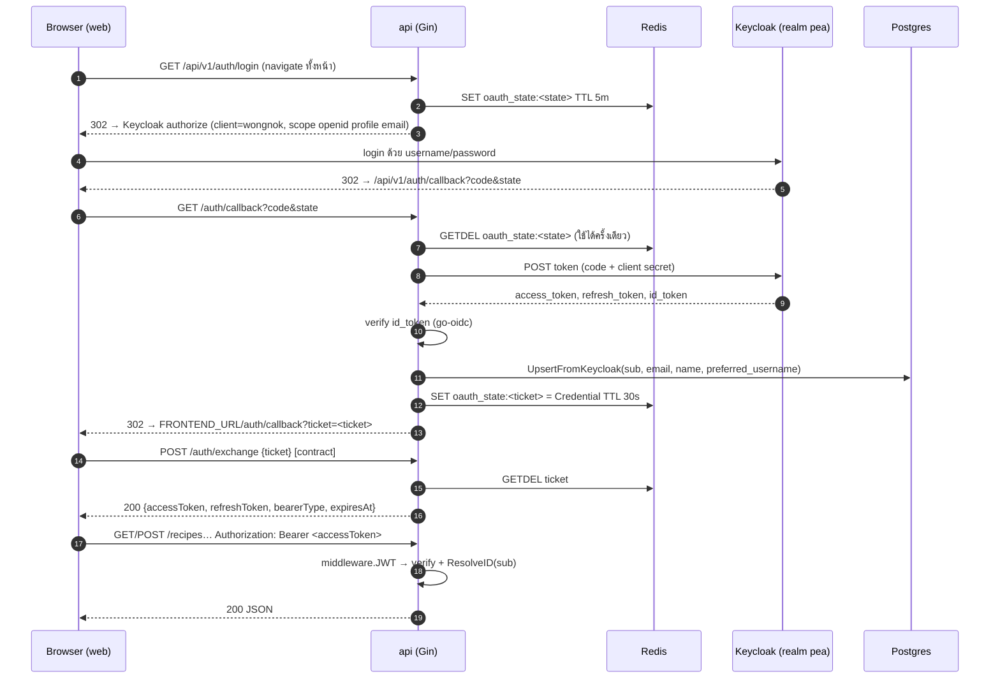
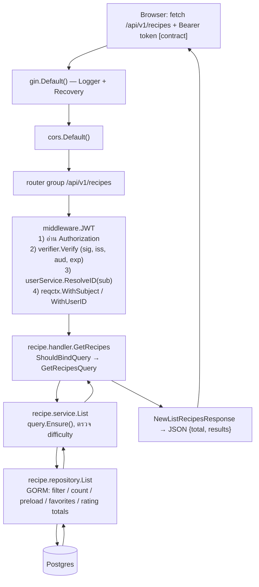

# System Architecture

> **เอกสารอ้างอิงจากคอร์ส** อธิบายโปรเจกต์ต้นแบบ `pea-wongnok` ที่โจทย์ให้อ่านก่อนทำ **ไม่ใช่แอป Booking Table นี้** (ชื่อ package, ตาราง, endpoint และรหัสผ่านตัวอย่างในนี้เป็นของต้นแบบ) ใช้เป็นธรรมเนียมการเขียนโค้ดเท่านั้น ของจริงของแอปนี้ดูที่ [api/docs](../../../api/docs/ARCHITECTURE.md) และ [README หลัก](../../../README.md)

> เอกสารนี้ reverse-engineer จาก source code ของโปรเจกต์ `pea-wongnok` (ระบบสูตรอาหาร "Wongnok") โดยถือ source code เป็น source of truth
> ทุกข้ออ้างอิงมี path ประกอบ ส่วนที่หลักฐานไม่พอจะระบุว่า **UNKNOWN**
> ไม่มีการเปิดเผยค่า secret — มีเฉพาะ *ชื่อ* environment variable
>
> เอกสารคู่กัน: [FRONTEND_ARCHITECTURE.md](FRONTEND_ARCHITECTURE.md) · [BACKEND_ARCHITECTURE.md](BACKEND_ARCHITECTURE.md)

---

## 1. Executive Summary

| หัวข้อ | สรุป |
| --- | --- |
| ระบบคืออะไร | เว็บแอปสูตรอาหาร: สร้าง/แก้/ลบสูตร, ค้นหา+กรอง, กด favorite, ให้คะแนน, โปรไฟล์ผู้ใช้ |
| รูปแบบสถาปัตยกรรม | **3-tier แยก service**: Next.js (web) ↔ Go REST API (api) ↔ PostgreSQL + Redis, มี Keycloak เป็น Identity Provider |
| Backend | Go + Gin จัดโค้ดเป็น *feature package* (`auth`, `user`, `recipe`) แต่ละ package แบ่ง Handler → Service → Repository (GORM) |
| Frontend | Next.js 16 (App Router) + React 19 + Tailwind v4 + shadcn/ui (base-nova) — **ตอนนี้ยังเป็น scaffold** ยังไม่มี API client / auth / หน้าฟีเจอร์ (ดู §15) |
| Authentication | **Backend-driven OAuth2 Authorization Code flow** (confidential client) + **one-time ticket hand-off** ให้ frontend; API ตรวจ JWT ด้วย OIDC verifier (go-oidc) |
| Authorization | ไม่มี role-based; ใช้ **ownership check** ใน service (`CreatorID != userID → ErrForbidden`) |
| Infra | `compose.yml` รัน 5 services: `postgres`, `redis`, `keycloak`, `api`, `web` |

> **ข้อสังเกตสำคัญที่สุด:** ฝั่ง `web/` ยังไม่มี logic ฟีเจอร์ใดๆ ทุกอย่างที่เกี่ยวกับ frontend↔backend ในเอกสารนี้
> จึงมาจาก **สัญญา (contract) ที่ฝั่ง backend กำหนด** (`api/docs/API.md`, `api/internal/auth/service.go`)
> ไม่ใช่จากโค้ดฝั่ง web — ทุกจุดที่เป็นแบบนี้จะติดป้าย **[contract]**

---

## 2. Technology Stack

| Technology | Evidence | Purpose |
| --- | --- | --- |
| Go 1.26 | `api/go.mod` (`go 1.26.4`), `api/mise.toml` | ภาษาของ backend |
| Gin v1.12 | `api/go.mod`, `api/cmd/api/main.go` | HTTP router / binding / middleware |
| GORM v1.31 + `gorm.io/driver/postgres` | `api/go.mod`, `api/internal/platform/database/postgres.go` | ORM |
| PostgreSQL 17 | `compose.yml` (`image: postgres:17`) | ฐานข้อมูลหลัก |
| goose (SQL migrations) | `api/AGENTS.md`, `api/migrations/*.sql` (`-- +goose Up/Down`) | migration — **รันด้วยมือ** ไม่ได้อยู่ใน compose/startup |
| Redis 8.10 + `go-redis/v9` | `compose.yml`, `api/internal/platform/cache/redis.go` | เก็บ OAuth state/ticket (TTL) และ cache |
| Keycloak 26.7 | `compose.yml`, `keycloak/import/pea-realm.json` | Identity Provider (OIDC) |
| `coreos/go-oidc/v3` + `golang.org/x/oauth2` | `api/go.mod`, `api/internal/auth/service.go`, `api/internal/middleware/jwt.go` | OIDC discovery, code exchange, verify token |
| `caarlos0/env` + `go-playground/validator` + `godotenv` | `api/internal/config/config.go` | โหลด+ตรวจ config จาก env |
| `log/slog` | `api/cmd/api/main.go` (`newLogger`) | structured logging (json/text) |
| swaggo (`swag`, `gin-swagger`) | `api/go.mod`, `api/docs/docs.go`, `api/docs/swagger.*` | Swagger UI ที่ `/swagger/*any` |
| testify + mockery + testcontainers | `api/go.mod`, `api/.mockery.yml`, `api/docs/TESTING.md` | testing |
| Next.js 16.3.4 (App Router) | `web/package.json`, `web/app/layout.tsx` | framework ของ frontend |
| React 19.2.8 | `web/package.json` | UI library |
| TypeScript 5 (strict) | `web/tsconfig.json` | ภาษาของ frontend |
| Tailwind CSS v4 | `web/package.json`, `web/postcss.config.mjs`, `web/app/globals.css` | styling |
| shadcn/ui (style `base-nova`) + `@base-ui/react` + `class-variance-authority` + `lucide-react` | `web/components.json`, `web/package.json`, `web/components/ui/button.tsx` | UI component system |
| npm | `web/package-lock.json`, `web/Dockerfile` (`npm ci`) | package manager |
| ESLint 9 + `eslint-config-next` | `web/eslint.config.mjs` | lint |
| Docker / Docker Compose | `compose.yml`, `api/Dockerfile`, `web/Dockerfile` | local orchestration |
| HTTP client ฝั่ง frontend | **UNKNOWN — insufficient evidence** (ไม่มี axios/fetch wrapper ใน `web/`; `api/docs/API.md` กล่าวถึง "axios" แต่ไม่มีใน `web/package.json`) | — |
| State management / form / validation ฝั่ง frontend | **UNKNOWN — insufficient evidence** (ไม่มี dependency ใน `web/package.json`) | — |
| Frontend tests | **UNKNOWN — insufficient evidence** (ไม่มี test runner ใน `web/package.json`) | — |

---

## 3. Repository Structure

```text
pea-wongnok-2026/
├── compose.yml                 # 5 services: postgres, redis, keycloak, api, web
├── .gitignore                  # ignore .env, binaries, coverage (Go-oriented)
├── keycloak/
│   ├── README.md               # วิธี import/export realm
│   └── import/pea-realm.json   # realm "pea" snapshot (มี client, scopes, user, credential hash)
├── api/                        # Go backend (module "wongnok")
│   ├── cmd/api/main.go         # entry point + DI + routes + graceful shutdown
│   ├── internal/
│   │   ├── auth/               # Keycloak login flow, ticket exchange, refresh, logout
│   │   ├── user/               # user profile + upsert จาก Keycloak
│   │   ├── recipe/             # recipe CRUD, favorite, rating
│   │   ├── middleware/jwt.go   # ตรวจ Bearer token
│   │   ├── reqctx/             # typed context keys (subject, userID)
│   │   ├── httputil/           # ErrorResponse
│   │   ├── convutil/           # pointer helpers
│   │   ├── config/             # env → struct + validation
│   │   └── platform/{database,cache}/   # เปิด connection Postgres / Redis
│   ├── migrations/*.sql        # goose migrations (users … recipe_ratings)
│   ├── docs/                   # API.md, ARCHITECTURE.md (ER), TESTING.md, swagger.*
│   ├── Dockerfile              # multi-stage → distroless
│   ├── .mockery.yml
│   └── AGENTS.md (CLAUDE.md → symlink)
├── web/                        # Next.js frontend (scaffold)
│   ├── app/{layout.tsx,page.tsx,globals.css}
│   ├── components/{ui,bases}/button.tsx
│   ├── lib/utils.ts
│   ├── components.json         # shadcn config
│   ├── Dockerfile              # dev image (next dev)
│   └── AGENTS.md               # เตือน: Next.js เวอร์ชันนี้มี breaking changes
└── docs/                       # (เอกสารชุดนี้)
```

หมายเหตุ: `web/components/`, `web/lib/`, `web/components.json` และการแก้ `web/app/*`, `web/package.json` **ยังเป็น uncommitted** ตาม `git status` ณ ต้นเซสชัน

---

## 4. Runtime Architecture



**การเริ่มต้นระบบ** (`compose.yml`):

1. `postgres`, `redis`, `keycloak` start (keycloak `start-dev --import-realm` โหลด `keycloak/import/pea-realm.json` ถ้า volume ว่าง)
2. `api` (`depends_on` 3 ตัวบน — **เป็นแค่ลำดับ start ไม่ได้รอ ready**) → `main.go` โหลด config, ต่อ Postgres, ping Redis, ทำ OIDC discovery กับ Keycloak; ถ้าขั้นใดล้ม process จะ exit (`os.Exit(1)`)
3. `web` (`depends_on: api`) รัน `npm run dev -- -H 0.0.0.0 -p 3000` พร้อม bind mount `./web:/app`

> ⚠️ เพราะ `depends_on` ไม่รอ healthcheck ถ้า Keycloak ยัง boot ไม่เสร็จ `api` อาจ exit ด้วย error "discover keycloak provider" — `restart: always` จะช่วยให้ลองใหม่ (อนุมานจาก `compose.yml` + `main.go`; ไม่ได้ทดลองรัน)

---

## 5. Service Communication

| จาก → ถึง | โปรโตคอล / ที่อยู่ | หลักฐาน |
| --- | --- | --- |
| Browser → web | HTTP `localhost:3000` | `compose.yml` (web ports) |
| Browser → api | HTTP `localhost:8080/api/v1` — ค่าอยู่ใน `NEXT_PUBLIC_API_BASE_URL` | `compose.yml` (comment อธิบายว่าต้องเป็น URL ที่ browser เรียกได้) |
| Browser → Keycloak | redirect (302) ที่ API สั่ง ผ่าน `oauth2.Config.AuthCodeURL` | `api/internal/auth/service.go` (`BuildLoginURL`) |
| Keycloak → Browser → api | redirect `KEYCLOAK_REDIRECT_URL` = `…/api/v1/auth/callback` | `compose.yml`, `keycloak/import/pea-realm.json` (`redirectUris`) |
| api → Keycloak | HTTP ภายใน network: `KEYCLOAK_BASE_URL=http://keycloak:8080` | `compose.yml`, `api/internal/config/keycloak.go` |
| api → Postgres | `POSTGRES_DSN` (host `postgres:5432` ภายใน compose) | `compose.yml`, `api/internal/platform/database/postgres.go` |
| api → Redis | `REDIS_HOST` / `REDIS_PORT` (`redis:6379`) | `compose.yml`, `api/internal/platform/cache/redis.go` |
| api → Browser (หลัง login) | redirect `FRONTEND_URL/auth/callback?ticket=…` | `api/internal/auth/service.go` (`HandleCallback`) |

**CORS:** `router.Use(cors.Default())` (`api/cmd/api/main.go:114`) — ค่า default ของ `gin-contrib/cors` อนุญาตทุก origin แต่อนุญาต header เพียง `Origin, Content-Length, Content-Type` (ไม่รวม `Authorization`); ไม่มี config เฉพาะ `FRONTEND_URL` (ดู §15 ข้อ 7)

**ข้อควรระวังเรื่อง hostname (UNKNOWN — needs manual verification):**
API ทำ discovery ที่ `http://keycloak:8080/realms/pea` (hostname ภายใน compose) และ `oauth2.Config.Endpoint` มาจาก discovery เอกสารนั้น
ถ้า authorization URL ที่ browser ถูก redirect ไปยังคงใช้ host `keycloak:8080` เครื่อง host จะ resolve ไม่ได้
ในโค้ด/compose **ไม่มีการแยก** "public URL" กับ "internal URL" ของ Keycloak (`KC_HOSTNAME_STRICT=false` ทำให้ Keycloak ใช้ host จาก request)
ยังไม่ได้รันระบบจริงจึงยืนยันไม่ได้ว่า login ผ่านใน compose ได้เลยหรือต้องเพิ่ม `/etc/hosts`
สิ่งที่บ่งชี้ว่าผู้สอนอาจรัน API นอก compose: default ใน config คือ `KEYCLOAK_BASE_URL=http://localhost:8081`, `REDIS_PORT=6380` (`api/internal/config/{keycloak,redis}.go`) ไม่ตรงกับพอร์ตใน compose

---

## 6. Authentication Architecture

**รูปแบบ:** Backend-driven Authorization Code flow. Frontend ไม่ได้คุยโปรโตคอล OIDC กับ Keycloak เอง
(ไม่มี `keycloak-js` / `next-auth` ใน `web/package.json`) — API เป็น confidential client ถือ client secret (`KEYCLOAK_CLIENT_SECRET`)



| ขั้น | ไฟล์ / ฟังก์ชัน |
| --- | --- |
| สร้าง state + login URL | `api/internal/auth/service.go` → `BuildLoginURL`; handler `Login` |
| รับ callback, แลก code, upsert user, ออก ticket | `service.go` → `HandleCallback`, `exchangeCode`; `user.Service.UpsertFromKeycloak` |
| แลก ticket เป็น credential | `service.go` → `ExchangeTicket`; handler `Exchange` |
| Refresh token | `service.go` → `RefreshToken` (form POST ไป `…/protocol/openid-connect/token`) |
| Logout | `service.go` → `Logout` (form POST ไป `…/protocol/openid-connect/logout`; คาดหวัง 204) |
| ตรวจ token ทุก request | `api/internal/middleware/jwt.go` → `JWT(verifier, userResolver)` |
| ส่งต่อตัวตนให้ handler | `api/internal/reqctx/context.go` → `WithSubject`, `WithUserID`, `UserID()` |

**Token ถูกเก็บที่ไหน (ฝั่ง browser): UNKNOWN — ไม่มีโค้ดใน `web/`** (API คืน token เป็น JSON body เท่านั้น ไม่ได้ set cookie — ดู `auth/handler.go` `Exchange`)

**Token ถูกแนบ request อย่างไร:** [contract] header `Authorization: Bearer <accessToken>` (`api/docs/API.md` § Conventions; `middleware/jwt.go` ใช้ `bearerPrefix = "Bearer "`)

**Authorization:** ไม่มีการตรวจ role/permission จาก token — ดู BACKEND-RULE ใน §12 และ [BACKEND_ARCHITECTURE.md](BACKEND_ARCHITECTURE.md) §14

---

## 7. Keycloak

แหล่งข้อมูล: `keycloak/import/pea-realm.json` (สรุปด้วยการอ่านโครงสร้าง — **ไม่คัดลอก secret/credential**), `keycloak/README.md`

| หัวข้อ | ค่าที่พบ |
| --- | --- |
| Realm | `pea` (enabled, `sslRequired=external`, `registrationAllowed=false`, `loginWithEmailAllowed=true`) |
| Access token lifespan | 3600 วินาที; SSO session idle 14400 วินาที |
| Client สำหรับแอป | `wongnok` — `publicClient=false` (confidential), `standardFlowEnabled=true`, implicit/direct-grant/service-account = false |
| Redirect URIs | `http://localhost:8080/api/v1/auth/callback` (ชี้ที่ **API** ไม่ใช่ frontend) |
| Post-logout redirect URIs | `http://localhost:3000/*` |
| Web origins | ว่าง |
| Protocol mapper | `wongnok-audience` (`oidc-audience-mapper`) — ใส่ audience `wongnok` ลง access token → ทำให้ `Verifier{ClientID: "wongnok"}` ผ่านการตรวจ `aud` |
| Default client scopes | `web-origins, acr, roles, profile, basic, email` |
| Realm roles | เฉพาะ built-in (`default-roles-pea`, `offline_access`, `uma_authorization`) — **ไม่มี custom role** |
| Users ที่ import | 1 คน (`dev@pea.co.th`) พร้อม credential hash ใน snapshot |
| Groups / Identity providers | ไม่มี |

**ความสัมพันธ์:**

```text
Frontend  ──(navigate)──▶ API /auth/login ──302──▶ Keycloak login page
Keycloak  ──302 (code)──▶ API /auth/callback ──(server-to-server token)──▶ Keycloak
API       ──302 (ticket)─▶ Frontend /auth/callback
Frontend  ──POST ticket──▶ API /auth/exchange ──▶ tokens
Frontend  ──Bearer token─▶ API (verified against Keycloak JWKS via OIDC discovery)
```

**การโหลด realm:** `compose.yml` mount `./keycloak/import` → `/opt/keycloak/data/import:ro` + `command: start-dev --import-realm`
นโยบายคือ `IGNORE_EXISTING` — ถ้า volume `wongnok-all-in-one-keycloak-data` มีข้อมูลแล้วจะไม่ import ซ้ำ (`keycloak/README.md`)
รีเซ็ต: `docker compose down && docker volume rm wongnok-all-in-one-keycloak-data && docker compose up -d`

---

## 8. Docker / Infrastructure

```text
docker compose (compose.yml)
├── postgres   postgres:17                      host 5532 → 5432   volume wongnok-all-in-one-pgdata
├── redis      redis:8.10-alpine                host 6479 → 6379   (ไม่มี volume)
├── keycloak   quay.io/keycloak/keycloak:26.7   host 8180 → 8080   volumes: keycloak-data + ./keycloak/import (ro)
├── api        build ./api (Dockerfile)         host 8080 → 8080   depends_on: postgres, redis, keycloak
└── web        build ./web (Dockerfile)         host 3000 → 3000   depends_on: api; bind mount ./web:/app
```

ไม่มี `networks:` กำหนดเอง → ทุก service อยู่ใน default network ของ compose คุยกันด้วยชื่อ service (`postgres`, `redis`, `keycloak`, `api`)

| Service | Build / Image | จุดที่ควรรู้ | หลักฐาน |
| --- | --- | --- | --- |
| postgres | image `postgres:17`, DB `wongnok` | ตัวแปร `POSTGRES_PASSWORD`, `POSTGRES_DB`; **ไม่มี migration อัตโนมัติ** | `compose.yml` |
| redis | `redis:8.10-alpine` | ไม่มี password/volume → ข้อมูลหายเมื่อ container ถูกสร้างใหม่ | `compose.yml` |
| keycloak | `26.7`, `start-dev` | ตัวแปร `KC_BOOTSTRAP_ADMIN_USERNAME/PASSWORD`, `KC_HOSTNAME_STRICT`, `KC_HTTP_ENABLED`; dev mode เท่านั้น | `compose.yml` |
| api | multi-stage: `golang:1.26.4-alpine` build → `distroless/static-debian12:nonroot` (static binary, user 65532) | `.dockerignore` กัน `.env`; COPY เฉพาะ `cmd/ internal/ docs/*.go` | `api/Dockerfile`, `api/.dockerignore` |
| web | `node:24-alpine`, `npm ci`, CMD `npm run dev -- -H 0.0.0.0 -p 3000` | **dev image เท่านั้น** (comment ใน Dockerfile) — anonymous volume `/app/node_modules`, `/app/.next` กัน bind mount ทับ | `web/Dockerfile`, `compose.yml` |

### ลำดับ startup สำหรับ local development (อนุมานจากไฟล์ — ยังไม่ได้ทดลองรัน)

```bash
# 1) ขึ้น infra + app ทั้งหมด
docker compose up -d --build

# 2) รัน migration ด้วย goose (ไม่อยู่ใน compose) — ชี้ DB ที่ host port 5532
cd api
#   สร้าง api/.env (อยู่ใน .gitignore) ตาม api/AGENTS.md:
#   GOOSE_MIGRATION_DIR=./migrations  GOOSE_DRIVER=postgres  GOOSE_DBSTRING=<DSN ไป localhost:5532/wongnok>
goose up

# 3) เปิด http://localhost:3000 (web), http://localhost:8080/swagger/index.html (Swagger),
#    http://localhost:8180 (Keycloak admin)
```

คำสั่ง `goose up` และตำแหน่ง `.env` อนุมานจาก `api/AGENTS.md` (ที่ระบุ `GOOSE_*` ใน `.env`) — ตัว repo **ไม่มี script/Makefile** สำหรับ migrate
ทางเลือกการพัฒนา API นอก compose (ให้ hot-reload ฝั่ง Go): **UNKNOWN** — ไม่มีไฟล์ `.env.example` หรือ script ยืนยัน

---

## 9. Environment Configuration

ระบุเฉพาะชื่อ (ไม่แสดงค่า) — ค่าจริงใน `compose.yml` เป็น hardcode (ดู §15)

### api (struct ใน `api/internal/config/*.go`, โหลดด้วย `env.ParseAs[Config]()`)

| Variable | Struct | Default (ใน code) | หมายเหตุ |
| --- | --- | --- | --- |
| `APP_NAME` | App | `wongnok` | ใช้เป็น field `service` ใน log |
| `APP_ENV` | App | `development` | `oneof=development staging production` |
| `APP_PORT` | App | `8080` | **ไม่ถูกใช้จริง** — `main.go` hardcode `":8080"` |
| `APP_SHUTDOWN` | App | `10s` | timeout ของ graceful shutdown |
| `POSTGRES_DSN` | Database | — (required) | ต้องมีชื่อ database |
| `REDIS_HOST`, `REDIS_PORT`, `REDIS_PASSWORD`, `REDIS_DB` | Redis | `localhost`, `6380`, —, `0` | |
| `KEYCLOAK_BASE_URL` | Keycloak | `http://localhost:8081` | |
| `KEYCLOAK_REALM` | Keycloak | `pea` | |
| `KEYCLOAK_CLIENT_ID` | Keycloak | — (required) | `wongnok` ใน compose |
| `KEYCLOAK_CLIENT_SECRET` | Keycloak | — (required) | **secret** |
| `KEYCLOAK_REDIRECT_URL` | Keycloak | `http://localhost:8080/api/v1/auth/callback` | ต้องตรงกับ redirect URI ใน realm |
| `FRONTEND_URL` | Keycloak | `http://localhost:3000` | ปลายทาง redirect พร้อม ticket |
| `LOG_LEVEL`, `LOG_FORMAT` | Logging | `DEBUG`, `json` | |
| `GOOSE_MIGRATION_DIR`, `GOOSE_DRIVER`, `GOOSE_DBSTRING` | (goose CLI) | — | อ่านจาก `.env` ตาม `api/AGENTS.md` |

โหลด `.env` อัตโนมัติผ่าน `_ "github.com/joho/godotenv/autoload"` (`api/internal/config/config.go`); `.env` ถูก ignore ใน `.gitignore`

### web

| Variable | ที่มา | หมายเหตุ |
| --- | --- | --- |
| `NEXT_PUBLIC_API_BASE_URL` | `compose.yml` (web.environment) | comment ระบุว่าถูก inline ลง client bundle → ต้องเป็น URL ที่ browser เรียกได้ (`localhost:8080`) **ไม่มีโค้ดใน `web/` อ่านตัวแปรนี้ตอนนี้** |
| `NODE_ENV` | `compose.yml` | `development` |

### ตัวแปรของ service อื่น (compose)
`POSTGRES_PASSWORD`, `POSTGRES_DB` (postgres) · `KC_BOOTSTRAP_ADMIN_USERNAME`, `KC_BOOTSTRAP_ADMIN_PASSWORD`, `KC_HOSTNAME_STRICT`, `KC_HTTP_ENABLED` (keycloak)

---

## 10. End-to-End Request Flow

กรณี request ปกติที่ผ่านการ login แล้ว (เช่น `GET /api/v1/recipes`):



**Error ที่ผู้เรียกจะเห็น:** `{ "message": "..." }` พร้อม HTTP status (400/401/403/404/500/502) — รูปแบบจาก `api/internal/httputil/response.go`; field `code` มีใน type แต่ไม่มี endpoint ใดกำหนดค่า (`api/docs/API.md`)

---

## 11. Example Feature Traces

> หมายเหตุ: ฝั่ง Frontend ของทุก trace เป็น **[contract]** — ไม่มี page/hook/service ใน `web/` ให้ trace จริง

### Trace A — Login (Auth feature)

```text
[Frontend] ปุ่ม Login → navigate ไป {API}/auth/login            [contract; ยังไม่มีโค้ด]
   ↓
api/cmd/api/main.go:121        authGroup.GET("/login", authHandler.Login)
   ↓
api/internal/auth/handler.go   (*handler).Login
   ↓
api/internal/auth/service.go   BuildLoginURL → generateRandomToken, repository.SaveState
   ↓
api/internal/auth/repository.go SaveState → Redis SET oauth_state:<state> (5 นาที)
   ↓ 302
Keycloak login → 302 → api/…/auth/callback?code&state
   ↓
auth/handler.go Callback → service.HandleCallback
   ├─ repository.ConsumeState (GETDEL)           → ผิด/หมดอายุ ⇒ ErrInvalidState ⇒ 401
   ├─ exchangeCode (oauth2.Exchange + verify id_token + parse claims)
   ├─ user.Service.UpsertFromKeycloak ⇒ user.repository (FindByUID / Create / Update) ⇒ Postgres `users`
   └─ repository.SaveTicket (Redis, 30 วินาที)
   ↓ 302 {FRONTEND_URL}/auth/callback?ticket=…
[Frontend] หน้า /auth/callback → POST /auth/exchange {ticket}      [contract; ยังไม่มีหน้านี้ใน web/app]
   ↓
auth/handler.go Exchange → service.ExchangeTicket → repository.ConsumeTicket (GETDEL) → Credential JSON
```

### Trace B — Create Recipe

```text
[Frontend] ฟอร์มสร้างสูตร → POST /recipes + Bearer token + JSON body   [contract]
   ↓
main.go:134-136   recipeGroup (JWT middleware) .POST("", recipeHandler.Create)
   ↓
middleware/jwt.go → ตั้ง reqctx UserID
   ↓
recipe/handler.go   Create
     • reqctx.UserID → ไม่มี ⇒ 401
     • ShouldBindJSON(&CreateRecipeRequest)  (binding: required, url, dive)  ⇒ ผิด ⇒ 400
     • service.Create(ctx, creatorID, req.ToRecipe())
   ↓
recipe/service.go   Create
     • repository.HasActiveReferences(difficultyID, durationID) ⇒ false ⇒ ErrInvalidReferenceData ⇒ 400
     • recipe.CreatorID = creatorID
   ↓
recipe/repository.go Create  — Transaction: insert recipes → insert ingredients → insert instructions
   ↓
Postgres: recipes, recipe_ingredients, recipe_instructions
   ↓
handler → 201 {"id": <int>}  (NewCreateRecipeResponse)
```

### Trace C — Favorite / List ที่กรองด้วย favorite

```text
POST /recipes/:id/favorite → recipe/handler.go Favorite → service.Favorite → repository.Favorite
   • INSERT … ON CONFLICT (user_id, recipe_id) DO UPDATE deleted_at=NULL    → idempotent, 204
GET  /recipes?favorite=true → handler.GetRecipes → service.List → repository.List
   • sub-query  id IN (SELECT recipe_id FROM user_favorites WHERE user_id = ?)
   • คืน isFavorite ต่อแถวผ่าน favoritedRecipeIDs
```

รายละเอียด request lifecycle ระดับโค้ดดู [BACKEND_ARCHITECTURE.md](BACKEND_ARCHITECTURE.md) §5, §18

---

## 12. Architecture Rules

กฎที่สรุปจาก pattern ที่ซ้ำในโค้ด (รายละเอียดเต็มอยู่ในเอกสาร Backend / Frontend)

### Authentication Rules

```text
AUTH-RULE-01  Frontend ไม่คุย OIDC กับ Keycloak โดยตรง — API เป็น confidential client
Evidence: auth/service.go (oauth2.Config + ClientSecret), web/package.json (ไม่มี OIDC lib)

AUTH-RULE-02  ห้ามส่ง token ผ่าน URL — ใช้ one-time ticket (Redis, TTL 30s, GETDEL)
Evidence: auth/service.go HandleCallback → SaveTicket; auth/repository.go ConsumeTicket

AUTH-RULE-03  OAuth state ใช้ครั้งเดียว + หมดอายุใน 5 นาที (กัน CSRF/replay)
Evidence: auth/service.go BuildLoginURL; auth/repository.go ConsumeState

AUTH-RULE-04  ทุก route ที่ไม่ใช่ /auth/* ต้องผ่าน middleware.JWT ที่ระดับ route group
Evidence: main.go:129, 135

AUTH-RULE-05  Identity ภายใน = UUID ของตาราง users (ไม่ใช่ Keycloak sub) — handler อ่านจาก reqctx เท่านั้น
Evidence: middleware/jwt.go (ResolveID), reqctx/context.go, ทุก handler ใน recipe/ เรียก reqctx.UserID

AUTH-RULE-06  User ถูกสร้าง/อัปเดตในตารางของเราตอน login (upsert จาก claims)
Evidence: user/service.go UpsertFromKeycloak ถูกเรียกจาก auth/service.go HandleCallback
```

### Infrastructure Rules

```text
INFRA-RULE-01  Service คุยกันด้วยชื่อ service ใน compose network; ค่าที่ browser ต้องเรียกใช้ต้องเป็น localhost + host port
Evidence: compose.yml (POSTGRES_DSN ใช้ host "postgres"; NEXT_PUBLIC_API_BASE_URL ใช้ localhost:8080 พร้อม comment)

INFRA-RULE-02  Realm ของ Keycloak เป็น code (JSON ใน repo) import ด้วย --import-realm
Evidence: compose.yml, keycloak/README.md

INFRA-RULE-03  Schema ถูกจัดการด้วย goose SQL migration เท่านั้น (ไม่ใช้ GORM AutoMigrate)
Evidence: api/migrations/*.sql; ไม่พบ AutoMigrate ใน api/ (grep ยืนยันได้)

INFRA-RULE-04  Image ของ API: static binary + distroless nonroot; .dockerignore กัน .env
Evidence: api/Dockerfile, api/.dockerignore
```

Frontend / Backend rules: ดู [FRONTEND_ARCHITECTURE.md §16](FRONTEND_ARCHITECTURE.md) และ [BACKEND_ARCHITECTURE.md §19](BACKEND_ARCHITECTURE.md)

---

## 13. Important Files

| ไฟล์ | ทำไมสำคัญ |
| --- | --- |
| `compose.yml` | ภาพรวม service/port/env ทั้งระบบ |
| `api/cmd/api/main.go` | startup, DI, route ทั้งหมด |
| `api/internal/auth/service.go` | หัวใจ login flow |
| `api/internal/middleware/jwt.go` | จุดบังคับ authentication |
| `api/internal/reqctx/context.go` | วิธีส่ง identity ลงไปยัง handler |
| `api/internal/recipe/{handler,service,repository,dto,model}.go` | แม่แบบ feature ที่สมบูรณ์ที่สุด |
| `api/internal/config/*.go` | แม่แบบการโหลด+ตรวจ config |
| `api/migrations/*.sql` | schema จริง |
| `api/docs/API.md` | API contract (เขียนมือ) — ฝั่ง frontend ต้องทำตาม |
| `api/docs/ARCHITECTURE.md` | ER diagram / กติกา domain |
| `keycloak/import/pea-realm.json` | การตั้งค่า realm/client |
| `web/components.json` | config ของ shadcn (alias, style) |
| `web/AGENTS.md` | เตือนว่า Next.js เวอร์ชันนี้ต่างจากที่เคยรู้ ให้อ่าน `node_modules/next/dist/docs/` |

---

## 14. Reusable Architecture for Future Projects

**ส่วนที่เอาไปใช้เป็นฐานได้ทันที (พิสูจน์แล้วว่าครบ+มี test):**

1. **Skeleton backend**: `cmd/api/main.go` + `internal/config` + `internal/platform/*` + `internal/{middleware,reqctx,httputil}` — ใช้เป็น template ได้เกือบทั้งก้อน
2. **Feature package template** (`dto/error/handler/model/repository/service` + mock): ก๊อป `recipe/` แล้วเปลี่ยนชื่อ
3. **Auth stack**: Keycloak realm + `auth/` package + `middleware/jwt.go` + `user.UpsertFromKeycloak` — ใช้ได้กับโดเมนใดก็ได้ที่ต้อง SSO
4. **Compose stack** (postgres + redis + keycloak + api + web) พร้อม realm import
5. **Testing recipe**: handler test (httptest + mockery), service test (mock repo), repository integration test (testcontainers) — `api/docs/TESTING.md`
6. **Frontend foundation**: Next.js 16 + Tailwind v4 + shadcn config พร้อม design tokens ใน `web/app/globals.css`

**ส่วนที่ต้องสร้างเองสำหรับ Final Project:** ทุกอย่างที่เป็น logic ฝั่ง frontend (API client, auth callback page, token storage/refresh, route guard, หน้าฟีเจอร์, form/validation, state) — ไม่มีตัวอย่างใน repo

**ส่วนที่ต้องเปลี่ยนเมื่อย้ายโดเมน:** module name `wongnok`, realm `pea`/client `wongnok`, ตาราง/model ใน `recipe`, ค่า seed ใน migrations, ข้อความ Thai ใน swagger annotation

---

## 15. Risks / Things I Must Understand Before Reusing It

> เป็น *ข้อสังเกตจากการอ่านโค้ด* ไม่ใช่ข้อเสนอให้ redesign — ยังไม่ได้รันโปรแกรมหรือ test เพื่อยืนยัน

### A. ข้อสังเกตที่ดูเป็นบั๊ก/จุดเสี่ยงในโค้ด (ควรตรวจก่อน copy)

| # | ที่ | ข้อสังเกต |
| --- | --- | --- |
| 1 | `api/internal/middleware/jwt.go:39` | หลัง `AbortWithStatusJSON(401, "user not found")` **ไม่มี `return`** โค้ดไหลต่อและเรียก `ctx.Next()` (Abort ทำให้ handler ถัดไปไม่รัน แต่ context ถูกตั้งด้วย `uuid.Nil`) |
| 2 | `api/internal/user/repository.go:65` | เงื่อนไข `err != nil` ใน `ResolveID` **กลับด้าน** → cache hit จะไม่ถูกใช้ ทุก request ไปอ่าน Postgres แล้วเขียน cache ซ้ำ (cache ไม่ได้ช่วย) |
| 3 | `api/internal/recipe/repository.go:267` | pagination ใช้ `db.Order((page-1)*limit)` แทนที่จะเป็น `Offset(...)` — ต้องทดสอบว่า page ≥ 2 ได้ผลถูกไหม (**needs manual verification**; มี integration test `TestRepositoryList` ที่ควรอ่านประกอบ) |
| 4 | `api/internal/recipe/dto.go:194` | `*recipe.Creator.Name` dereference pointer โดยไม่เช็ก nil — ผู้ใช้ที่ไม่มี `name` จาก Keycloak อาจทำให้ panic |
| 5 | `api/cmd/api/main.go:110` | `gin.SetMode(gin.ReleaseMode)` ถูกเรียก**หลัง** `gin.Default()` จึงอาจไม่มีผลต่อ logger/debug ที่สร้างไปแล้ว |
| 6 | `api/cmd/api/main.go:150` | พอร์ต `":8080"` hardcode — `APP_PORT`/`Addr()` ไม่ได้ถูกใช้ |
| 7 | `api/cmd/api/main.go:114` | `cors.Default()` อนุญาตทุก origin **แต่ `AllowHeaders` default มีเพียง `Origin, Content-Length, Content-Type`** (ตรวจที่ `gin-contrib/cors@v1.7.7/cors.go:193`) ไม่รวม `Authorization` → browser ที่เรียกข้าม origin (`:3000` → `:8080`) พร้อม Bearer token จะโดน preflight ปฏิเสธ จนกว่าจะตั้ง CORS config เอง (ยังไม่ได้ทดสอบกับ browser จริง — **needs manual verification**) |
| 8 | `api/internal/auth/repository.go` | state และ ticket ใช้ prefix `oauth_state:` เดียวกัน (key space ร่วมกัน) |
| 9 | `api/internal/user/handler.go` vs `api/internal/recipe/handler.go` | user handler ตอบ 404/400/500 ด้วย `err.Error()` ตรงๆ (อาจรั่ว message ภายใน) ขณะที่ recipe handler ใช้ข้อความทั่วไป ("internal server error", "invalid request") — สไตล์ไม่สม่ำเสมอ; และ `GET/PUT /users/:id` รับเฉพาะ `id = me` |
| 10 | `/difficulties`, `/durations` | อยู่ใน `API.md` แต่ **ยังไม่มี route** (`API.md` ระบุเองว่า not implemented) — frontend ที่ต้องทำ dropdown จะต้องเพิ่ม endpoint หรือ hardcode ค่า |
| 11 | `api/docs/API.md` | `Authorization` บน `/auth/logout` ใน swagger เขียนว่าใช้ BearerAuth แต่จริงไม่บังคับ (`API.md` §Auth ระบุไว้เอง) |

### B. ความเสี่ยงด้าน config/secret
- `compose.yml` มี password, admin credential และ `KEYCLOAK_CLIENT_SECRET` ฝังเป็นข้อความ และ client secret เดียวกันอยู่ใน `pea-realm.json` → เป็นค่า dev เท่านั้น **ห้ามนำไปใช้จริง/ห้าม commit ค่าใหม่**; Final Project ควรใช้ `.env` + `.env.example`
- `pea-realm.json` มี credential hash ของ user dev
- Keycloak ใช้ `start-dev` + HTTP (`KC_HTTP_ENABLED`) — ไม่เหมาะ production

### C. สิ่งที่ต้องเข้าใจก่อนเริ่ม Final Project
1. **Frontend ยังว่าง** — ต้องออกแบบ/เขียน auth callback, token storage+refresh, API client เอง โดยทำตาม `api/docs/API.md`
2. **Redirect URI ใน Keycloak ชี้ที่ API** (`:8080`) ไม่ใช่ frontend — ถ้าเปลี่ยน port/host ต้องแก้ทั้ง `KEYCLOAK_REDIRECT_URL` และ realm
3. **Hostname ของ Keycloak** (ภายใน vs. ที่ browser เห็น) — ดู §5 ต้องทดสอบจริงก่อนสรุป
4. **Migration ไม่รันอัตโนมัติ** — DB ใหม่จะว่างจนกว่าจะ `goose up`
5. **Token lifespan 1 ชม.** และ refresh ผ่าน API — frontend ต้องจัดการ 401/refresh เอง
6. `web/AGENTS.md` เตือนว่า Next.js 16 มี breaking changes — อ่าน `node_modules/next/dist/docs/` ก่อนเขียนโค้ด
7. ส่วน `web/` ยังไม่ commit — สถานะ repo ของ web อาจเปลี่ยน

---

## 16. Unknowns

| หัวข้อ | สถานะ |
| --- | --- |
| HTTP client / state / form / validation ฝั่ง frontend | UNKNOWN — insufficient evidence (ไม่มีโค้ด) |
| ที่เก็บ token ใน browser (memory/localStorage/cookie) | UNKNOWN |
| หน้า frontend `/auth/callback` และ route guard | UNKNOWN — ยังไม่มี; มีแต่ URL ที่ backend redirect มา |
| Login ทำงานครบวงจรภายใน compose ได้หรือไม่ (ปัญหา hostname `keycloak:8080`) | UNKNOWN — needs manual verification |
| วิธีรัน API แบบ local นอก compose อย่างเป็นทางการ | UNKNOWN (ไม่มี `.env.example`/Makefile) |
| คำสั่ง regenerate swagger (`swag init`) | UNKNOWN — ไม่มี script; `api/docs/docs.go` เป็นไฟล์ generated และ Dockerfile COPY `docs/*.go` |
| `goose up` ถูกรันในกระบวนการสอนอย่างไร / ใช้ goose เวอร์ชันใด | UNKNOWN |
| Production deployment (CI/CD, image registry, TLS, reverse proxy) | UNKNOWN — ไม่มีหลักฐาน |
| ผลการรัน test suite ปัจจุบัน | UNKNOWN — ไม่ได้รัน (เอกสารนี้ไม่ได้ execute โค้ด) |
| การทำงานของ pagination (`Order` vs `Offset`) | UNKNOWN — needs manual verification |
